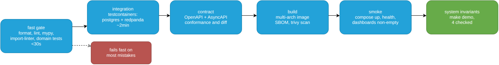
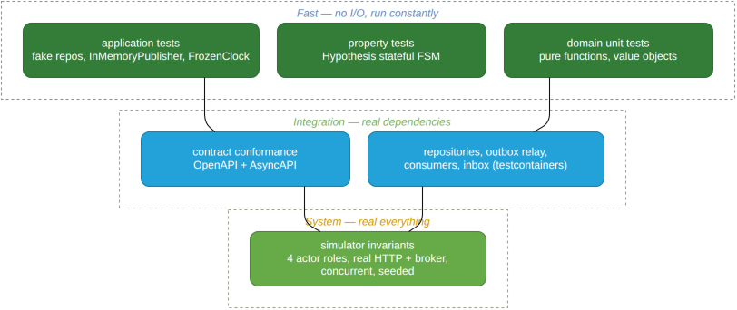

# Contributing

This document doubles as a statement of the engineering standards the repository holds itself to.
Everything here is machine-enforced — none of it depends on anyone remembering.

- [Local setup](#local-setup)
- [Quality gates](#quality-gates)
- [CI pipeline](#ci-pipeline)
- [Testing strategy](#testing-strategy)
- [Code standards](#code-standards)
- [Database changes](#database-changes)
- [Changing a wire contract](#changing-a-wire-contract)
- [Adding a metric](#adding-a-metric)
- [Making a decision](#making-a-decision)

---

## Local setup

```bash
uv sync --all-extras          # ~10s, lockfile-pinned
pre-commit install
make up                       # stack in Docker; nothing runs on the host
make test                     # fast gate, <30s, no containers
```

`uv` for resolution and installation, `uv.lock` committed. Python 3.12 pinned in
`.python-version` and in the base image digest — "works on my machine" is a solved problem and it is
solved by pinning.

---

## Quality gates

| Gate | Tool | Scope |
|---|---|---|
| Format | `ruff format` | everything |
| Lint | `ruff check` | everything, with `--select ALL` and a documented ignore list |
| Types | `mypy --strict` | `domain/`, `application/` |
| Types | `mypy` (default) | `adapters/`, `tests/`, `simulator/` |
| Types | `mypy --strict` | `forno_mcp/` (own project, `make test-mcp`, own CI job — tests relaxed) |
| Layers | `import-linter` | four contracts (the fourth keeps `forno_mcp` external, ADR-0011) |
| Security | `bandit`, `pip-audit` | installed as dev deps, not yet wired into `make test`/CI |
| Tests | `pytest` | see below |

**Graduated type strictness is a deliberate judgement, not laziness.** `--strict` everywhere means
fighting SQLAlchemy and FastAPI decorator typing for no correctness gain. The pure layers — where
the business rules live and where a type error is a logic error — carry the strict setting. The
boundary layers, where the framework already constrains shapes, do not.

The ignore list in `pyproject.toml` carries a comment per entry explaining the exemption. An ignore
list without reasons is a list nobody can ever safely shorten.

---

## CI pipeline



Source: [`ci-pipeline.drawio`](docs/media/ci-pipeline.drawio).

The split exists for one reason: **feedback latency shapes behaviour.** A single 8-minute job means
people stop running anything locally and push to find out. A 30-second gate that catches most
mistakes gets run before every commit, by everyone, without being told.

The invariant job is last because it is the most expensive and the most informative. When it fails,
the printed report says which of the four checked invariants broke (see [Simulator](docs/simulator.md)
"The shadow ledger" for why it's four, not the ten a first draft of this design sketched out).

---

## Testing strategy



Source: [`testing-strategy.drawio`](docs/media/testing-strategy.drawio).

**The pyramid is deliberately narrow in the middle.** Because the simulator covers end-to-end
behaviour properly, the integration layer only needs to test what genuinely touches infrastructure —
SQL, offsets, transaction boundaries. That is what keeps the suite from turning into a wall of
mocks that assert the code calls the functions it calls.

Rules:

- **No mocks for code you own.** Use the ports — `InMemoryPublisher`, `FrozenClock`, fake
  repositories. A `Mock` asserting `save.assert_called_once()` tests the implementation, not the
  behaviour, and it fails on every refactor while catching no bugs.
- **`FrozenClock` for anything time-dependent.** A test that calls `datetime.now()` is a test that
  fails at midnight on a Tuesday in a different timezone.
- **Test names are the specification.** `test_cannot_cancel_once_in_oven`, not `test_cancel_2`.
- **One behaviour per test.** If the name needs "and", split it.
- **Property tests for the FSM.** Randomised legal command sequences reach interleavings nobody
  writes by hand — cancel-during-remake, scrap-after-ready — which is exactly where FSM bugs live.

---

## Code standards

**Type everything at the boundaries.** `NewType` identifiers (`OrderId`, `TableId`) so it is
impossible to pass one where another belongs. Value objects (`Money`, `PromisedTime`) rather than
bare `Decimal` and `datetime`. Both are free at runtime and caught by `mypy`.

**No framework imports in `domain/`.** Enforced. If a domain concept seems to need Pydantic, it
needs a plain dataclass and a mapping function in `contracts/`.

**Docstrings only where the *why* is not obvious.** `"""Returns the order."""` above
`def get_order()` is noise, and noise trains readers to skip docstrings — including the one that
mattered. Comment the surprising decision, the reason for the ordering, the constraint that is not
visible locally.

**`domain/order.py` past ~300 lines is a design smell.** The whole ruleset should fit in one
readable file. If it does not, the aggregate boundary is probably wrong.

**Errors are domain exceptions, mapped at the edge.** `raise IllegalTransition(...)` in the domain;
one FastAPI handler turns it into `409 problem+json`. Never `HTTPException` below `adapters/http/`.

**Structured logging only.** `log.info("item.oven_in", order_id=…, oven=…)` — stable dotted event
names, never interpolated prose. You can aggregate on the first and not the second.

---

## Database changes

Alembic, one migration per PR, both directions tested.

- **Every migration must be safe to run against a live system**, because the deployment model is
  rolling. That means: add columns nullable, backfill separately, make them non-null in a later
  release. Never rename in a single step — add, dual-write, migrate, drop.
- **Indexes concurrently.** `CREATE INDEX CONCURRENTLY` outside a transaction, or the migration
  takes a lock that stops the pizzeria mid-service.
- Intended CI step (not wired up yet): `upgrade head`, then `downgrade -1`, then `upgrade head`
  again against a fresh container. A downgrade nobody has ever executed is not a rollback plan.

---

## Changing a wire contract

Events on a topic are a published API. Consumers may be older than producers during any rolling
deploy, so:

1. **Additive changes only** within a `schema_version`. New optional fields are fine; removing or
   retyping a field is not.
2. **Breaking change → new version.** `OrderPlacedV2` alongside `V1`. Producers emit both during the
   transition; consumers handle both; `V1` is removed only when the retention window has passed.
3. **Never guess at an unknown version.** Consumers route it to the DLQ as `poison` and alert. A
   consumer that silently ignores fields it does not understand corrupts state quietly, which is the
   worst available failure mode.
4. **Designed, not built yet:** committing `openapi.json`/`asyncapi.json` and having CI diff them on
   every change. `tests/contract/test_openapi_conformance.py` and `test_asyncapi_conformance.py`
   exist as skipped stubs for exactly this — picking one up is a good first contribution. Until
   then, a wire-contract change is only caught by the simulator's consumer-driven run
   (`make demo`), not by an explicit diff. See [API contract](docs/api.md) "Contract testing".

---

## Adding a metric

Four questions, answered in the PR description:

1. **What question does it answer during an incident?** If there is no such question, it is noise —
   and noise in a metrics registry is expensive both to store and to ignore.
2. **What is its cardinality, worst case?** No `order_id`, no `table_number`, no
   `correlation_id`, no raw path, no error string. Bounded label sets only. Per-order detail belongs
   in logs and traces, which are built for it.
3. **Does it follow the conventions?** `forno_` prefix, base units, `_total` on counters, `_seconds`
   on durations.
4. **If it is a histogram, are the buckets domain-appropriate?** Default buckets stop at ten seconds,
   which is useless for something that takes eight minutes. Wrong buckets make every percentile in
   the dashboard meaningless while looking entirely plausible.

New metrics that appear on a dashboard need a panel in the provisioned JSON, in the same PR.
Instrumentation nobody looks at decays.

---

## Making a decision

Anything that a future reader might reasonably question gets an
[ADR](docs/adr/). The bar is not importance — it is **non-obviousness**.

The required sections are the standard ones plus one this project insists on:

> **What would change this.** The specific, observable signal that should cause someone to revisit
> the decision.

A decision without a stated reversal condition is a preference. With one, it is a hypothesis that
can be tested — and it saves the next person from either cargo-culting it forever or overturning it
without understanding what it was protecting.

Copy the shape of [ADR-0002](docs/adr/0002-transactional-outbox.md); it has the measured ceiling and
the migration path, which is the form to aim for.
