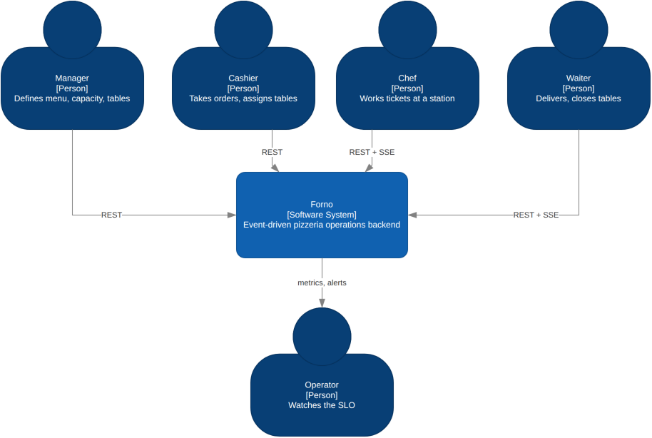
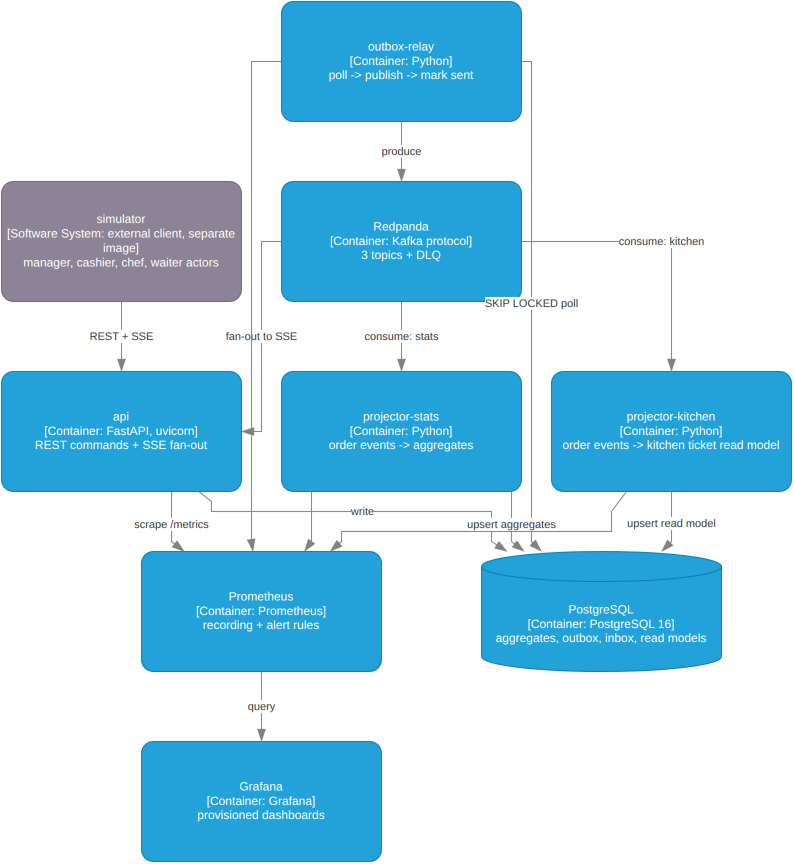

# Forno

**An event-driven pizzeria operations backend — built to be run, broken, and inspected.**

[](.github/workflows/ci.yml)
[](pyproject.toml)
[-brightgreen)](pyproject.toml)
[](importlinter.ini)

---

> *One command starts a fully configured pizzeria, a crowd of simulated customers, three chefs,
> two waiters, and a Grafana dashboard showing exactly how the kitchen is coping.
> A second command kills the kitchen mid-service and proves nothing was lost or duplicated.
> A third runs it in real time, open-ended, for as long as you want to watch.*

## About this project

Forno is a portfolio project by [Bartosz Lipiński](https://github.com/baka10): a complete,
production-shaped backend built end to end — domain model, event pipeline, operational tooling,
tests and documentation — to show how I design and ship systems, not just that I can write code.
The pizzeria is a deliberately small domain with genuinely hard properties (shared resources, hard
deadlines, concurrency), chosen so that every design decision can be read, run and argued with in
an afternoon. Everything here is runnable with one command and verified by the simulator in CI.

```bash
make demo SCENARIO=busy-friday     # runs a two-hour dinner service in about a minute, prints the invariant report
make chaos                         # SIGKILLs a consumer at peak load
make demo SCENARIO=understaffed    # deliberately breaches the SLO and fires the alerts
make live                          # real time, open-ended — watch Grafana move. Ctrl-C to stop
```

---

## Why this exists

A pizzeria looks like CRUD. It isn't.

It is a **shared-resource scheduling problem with a hard freshness deadline**: two orders land at
once, there is one oven with six slots, and the four pizzas for table 7 must reach the pass within
the same 90 seconds or the first ones go cold. Every interesting property of a production backend
falls out of that constraint — ordering guarantees, idempotency, backpressure, compensating actions,
and an SLO that a non-engineer would recognise as "was the food any good".

This repository is a complete, runnable implementation of that system, plus the operational
apparatus you would actually need to run it: metrics that answer questions, alerts with an error
budget, a runbook, and a deterministic simulator that doubles as a system-level property test.

## What it demonstrates

| Concern | How it shows up here |
|---|---|
| **Async Python** | FastAPI + asyncio end to end, async SQLAlchemy 2.0, SSE fan-out to live clients |
| **Event-driven architecture** | Redpanda (Kafka protocol), per-order partition ordering, read-model projectors |
| **Distributed correctness** | Transactional outbox, consumer-side inbox, idempotency keys, DLQ with failure classification |
| **Domain modelling** | Explicit FSMs, value objects, price snapshotting, illegal transitions as `409` |
| **Architecture** | Shallow hexagonal layering, machine-enforced by import-linter in CI |
| **Observability** | RED + domain metrics, SLO with multi-burn-rate alerts, correlation IDs across the async boundary |
| **Infrastructure** | One image / three roles, multi-stage builds, compose profiles, seeded dashboards |
| **Testing** | Property-tested FSM, testcontainers integration, and a simulator that asserts system invariants |
| **Extensibility** | A documented, unimplemented CP-SAT seam with the input model already shaped for it |

## Documentation

| Document | Read it for |
|---|---|
| [Architecture](docs/architecture.md) | Context and container diagrams, request/event flows, layering rules |
| [Domain model](docs/domain-model.md) | Aggregates, state machines, invariants, money handling |
| [API contract](docs/api.md) | Endpoint catalogue, SSE streams, error model, idempotency |
| [Observability](docs/observability.md) | Metric catalogue, SLO definition, alert rules, dashboards |
| [Simulator](docs/simulator.md) | Actors, determinism, time scaling, asserted invariants |
| [MCP server](docs/mcp.md) | Tools, resources and prompts for coding agents; how to connect Claude Code, Copilot, Claude Desktop |
| [Configuration](docs/configuration.md) | Scenario files, domain capacity vs. simulation behaviour |
| [Runbook](docs/runbook.md) | What to do when an alert fires |
| [ADRs](docs/adr/) | Every non-obvious decision, with the option that was rejected |

---

## Architecture at a glance

C4 model — [system context](docs/media/architecture-c4-context.drawio.png) and
[containers](docs/media/architecture-c4-containers.drawio.png), generated from
[`architecture-c4.drawio`](docs/media/architecture-c4.drawio) (open it in
[draw.io](https://app.diagrams.net/) to edit, or click through the drill-down link from the
System Software System box to the container level):





The single most important property: **Postgres is the system of record, Redpanda is propagation
only.** No event sourcing. A reviewer can verify correctness by reading a table.

Because a database commit and a broker publish cannot be made atomic, every state change writes an
`outbox` row inside the same transaction as the aggregate, and a relay process publishes it
afterwards. This is the one piece of machinery that makes "I used Kafka" mean something —
see [ADR-0002](docs/adr/0002-transactional-outbox.md).

---

## Quick start

**Requirements:** Docker with Compose v2, GNU Make, and [uv](https://docs.astral.sh/uv/) —
`make up` runs the fast test gate first, and that needs a local Python toolchain (`uv sync`
installs it, lockfile-pinned).

```bash
git clone https://github.com/baka10/forno && cd forno
make up          # core + observability, healthy in <60s
```

| Service | URL | Credentials |
|---|---|---|
| API docs (OpenAPI, FastAPI-generated) | http://localhost:8000/docs | `X-API-Key: dev` |
| Grafana | http://localhost:3000 | `admin` / `admin` |
| Prometheus | http://localhost:9090 | — |
| Redpanda console | http://localhost:8080 | — |
| pgAdmin | http://localhost:5050 | `admin@forno.dev` / `admin` — `forno` server pre-connected |

An AsyncAPI spec for the SSE streams and a protocol demo page are both described in
[docs/api.md](docs/api.md) as intended additions — neither is built yet (the AsyncAPI conformance
test is a skipped stub, `tests/contract/test_asyncapi_conformance.py`), so there's no `/asyncapi`
or `/demo` route to hit. `/docs` (Swagger UI) is what FastAPI generates automatically from the
same route definitions and is genuinely live.

`make up` doesn't have to leave you with an empty system: on first run, if the menu is still empty
and you're at an interactive terminal, it asks whether to populate the pizzeria from
`scenarios/busy-friday.yaml` — menu, ovens, stations, tables and shifts, through the same
`ManagerActor.bootstrap()` the simulator itself uses (`make seed` any time you want it manually, or
`SCENARIO=<name> make seed` for a different one). Say yes and the dashboards have data in them from
the first request. Empty panels are how portfolio projects die.

### Make targets

| Target | Effect |
|---|---|
| `make up` / `make down` | Core + observability stack |
| `make seed SCENARIO=<name>` | Populate the pizzeria from a scenario file — no traffic started |
| `make clear` | Stop everything and remove local images, volumes, orphans (pulled images untouched) |
| `make demo SCENARIO=<name>` | Run a full simulated service from an empty pizzeria (volumes are reset), finite, and print the invariant report |
| `make live` | Same simulator, real time (`time_scale: 1`), open-ended — Ctrl-C to stop |
| `make chaos` | Kill the kitchen projector at peak load, then prove recovery |
| `make test` | Fast gate: lint, mypy, import-linter, pure domain tests (<30s, no containers) |
| `make test-integration` | Testcontainers: Postgres + Redpanda |
| `make mcp` / `make mcp-http` | MCP server for coding agents, stdio or Streamable HTTP — see [MCP server](docs/mcp.md) |
| `make test-mcp` | The MCP server's gate: mypy strict + tests with a real MCP client |
| `make logs SERVICE=api` | Follow structured logs, pretty-printed |
| `make lint` | `ruff check --fix` + `ruff format` |
| `make migrate` | Apply pending Alembic migrations against the running Postgres container |
| `make build` | Build every service image |

---

## Scenarios

Any pizzeria from a two-table trattoria to a high-volume operation is expressed as one YAML file.
The **manager actor reads it and calls the public management API** — the topology arrives through
the front door, exactly as a real owner would enter it on day one. There is no separate seeding
path to drift out of sync.

```yaml
# scenarios/busy-friday.yaml
pizzeria:                     # domain capacity — the application must know this
  ovens:
    - {name: deck-1, slots: 8, bake_seconds: 480}
    - {name: deck-2, slots: 6, bake_seconds: 480}
  stations:
    prep: {count: 2, seconds_per_item: 120}
    pass: {count: 1}
  tables:  [{number: 1, seats: 4}, {number: 2, seats: 2}]
  staff:   {cashiers: 1, chefs: 3, waiters: 2}

simulation:                   # behaviour — the application must never know this
  seed: 42
  duration_minutes: 120
  time_scale: 120             # 480 domain seconds → 4 wall-clock seconds
  arrivals:
    model: poisson
    per_hour: 14
    rush: {at: "19:00", duration_minutes: 45, multiplier: 1.5}
  behaviour:
    remake_rate: 0.03
    walkout_after_seconds: 1500
```

That split is load-bearing. If `domain/` ever learns what a Poisson arrival rate is, the boundary
has leaked — see [Configuration](docs/configuration.md).

| Scenario | Purpose |
|---|---|
| `tiny-trattoria` | 6 tables, 1 oven, 1 chef. The smallest thing that works. |
| `busy-friday` | The default. Comfortable capacity with a 19:00 rush. |
| `understaffed` | **Tuned to breach the SLO.** Burns the error budget and fires the alerts on demand. |
| `oven-down` | `busy-friday` until 40 minutes in, when the manager takes `deck-2` out of service through the API. Promises lengthen, nothing is lost, the breach rate climbs. |
| `price-change` | The margherita goes up mid-service. Orders placed before keep their snapshotted total. |

`understaffed` is the most useful file in this repository. A system that can demonstrate its own
alerting firing, reproducibly, in one command, is making a claim it can back up.

---

## The simulator is an external client

The simulator lives in a **separate top-level package** and talks to the system exclusively over the
public HTTP API and SSE streams. No imports from `src/forno`, no database access, no shared session.
This is enforced by an import-linter contract, so CI fails if the boundary is crossed.

That constraint buys four things from one piece of code:

1. **A demo** you can run in a minute (`make demo`), or leave running in real time indefinitely
   (`make live`) while you watch Grafana.
2. **A load generator** that drives real traffic through the public API.
3. **Proof that the API is sufficient for a frontend that was never written.** The waiter actor
   consumes the SSE stream, renders nothing, and reacts correctly. If it can do its job through the
   public contract, the contract is complete. Every time the simulator wanted a shortcut, that was a
   real gap in the API — and it got fixed in the API.
4. **A system-level property test.** The simulator maintains a shadow ledger built purely from what
   an external observer can see, and asserts a deliberately small set of things on it — not every
   invariant the design sketched out, only the ones cheaply and honestly checkable from outside:

   - no item is ever observed delivered twice
   - `pizzas produced <= ordered + remakes − scrapped`
   - promise-breach rate falls inside the band the scenario declares
   - walkouts stay under the scenario's declared ceiling

   This runs as the top CI gate (`make demo`, exit code non-zero on any failure). It is stronger
   evidence than the unit suite for what it does check, because it exercises the real transport
   under real concurrency — see [Simulator](docs/simulator.md) "The shadow ledger" for the full
   list of what is and isn't checked yet, and why.

Details in [Simulator](docs/simulator.md).

---

## An MCP server for coding agents

`forno_mcp/` lets an agent (Claude Code, Copilot agent mode, Claude Desktop) work with the **running**
pizzeria the way an operator would, instead of guessing from `curl` output:

- **Understand** — a service snapshot (open and late orders, ovens, SLI vs. SLO, firing alerts) and
  `diagnose`, which walks the runbook's triage tree with the alert thresholds and answers the first
  question that matters: *is the software broken, or are there more customers than chefs?*
- **Watch and explain** — a bounded view of the SSE streams told as a story, and any order explained
  against its promise and its state machine.
- **Experiment** — run a simulator scenario against the live stack and read its invariant report, or
  take an oven out of service (both annotated as destructive, so the client asks first).
- **Read the rules** — the domain model, runbook, ADRs and scenarios as MCP resources.

It is an external client like the simulator, enforced by import-linter
([0011](docs/adr/0011-mcp-server-as-external-operator-client.md)). The repo ships a `.mcp.json`, so
Claude Code picks it up when you open the project. Details in [MCP server](docs/mcp.md).

---

## Observability

Request rate and CPU prove nothing. These are the metrics an actual operator would stare at:

| Metric | Why it, and not the obvious alternative |
|---|---|
| `forno_kitchen_oldest_ticket_age_seconds` | **Age, not depth.** Queue depth without throughput is meaningless; age is the SLI. |
| `forno_promise_late_seconds` | Histograms cannot hold negatives, so early and late are separate series. |
| `forno_outbox_lag_seconds` | The metric that watches the system's own weakest joint. |
| `forno_oven_slots_occupied` | Tells the owner whether to buy a second oven. |
| `forno_dlq_messages_total{classification}` | Retryable vs. poison vs. caller error — three different human responses. |

**SLO:** 95% of accepted orders reach `READY` no later than `promised_at + 120s`, over a rolling
30-day window. The error budget drives multi-window, multi-burn-rate alerts (14.4× over 5m/1h for
page, 6× over 30m/6h for ticket) rather than a static threshold that pages you at 3am for a blip.

No metric is labelled by `order_id` or `table_id`. Cardinality is a production outage waiting to
happen, and the label sets here are deliberately bounded.

**One correlation ID crosses every boundary.** `X-Request-ID` is captured at the edge, written onto
the outbox row, carried as a Kafka message header, and rehydrated into the consumer's structlog
context. One order's journey through API → outbox → broker → projector → SSE is a single `grep`.
That mechanism is what makes metrics, logs and traces one system instead of three.

Full catalogue, dashboards and alert rules: [Observability](docs/observability.md).

---

## Where the hard version plugs in

Promised ready time is currently computed by a naive estimator: total bake time divided by available
oven slots, plus a fudge factor. It is deliberately unimpressive, and it lives behind a port:

```python
class PromiseEstimator(Protocol):
    def promise(self, order: Order, state: KitchenState) -> PromisedTime: ...
```

The interesting part is not the protocol — anyone can declare one. It is that **`KitchenState`
already carries everything a constraint solver would need**: per-slot oven occupancy with release
times, per-item bake and prep durations, station capacities, and the fire-together groupings that
make this a scheduling problem rather than a queue. The naive estimator reads two of those fields
and ignores the rest.

[ADR-0007](docs/adr/0007-cp-sat-promise-estimator-seam.md) specifies the CP-SAT model in full —
decision variables, the fire-together window constraint, the objective function, the time budget and
the fallback behaviour when the solve times out. It is unimplemented and completely described.

A second estimator is a pull request, not a rewrite: register it under `FORNO_PROMISE_ESTIMATOR`,
and — because the simulator is deterministic (same seed, same scenario, same order stream, on any
machine) — the two can be compared on identical traffic.

---

## Design decisions worth arguing with

Every one of these is written up as an ADR with the alternative that was rejected and the specific
symptom that would change the answer.

- **Postgres is the system of record; no event sourcing.** ([0001](docs/adr/0001-postgres-system-of-record.md))
- **Transactional outbox, hand-written, not Debezium** — with the throughput ceiling measured and
  the migration path defined. ([0002](docs/adr/0002-transactional-outbox.md))
- **Redpanda over Kafka** in development, identical protocol, a third of the CI time. ([0003](docs/adr/0003-redpanda-over-kafka.md))
- **SSE, not WebSockets** — these streams are strictly server→client. ([0004](docs/adr/0004-sse-over-websockets.md))
- **Global layers, not package-by-feature**, at this size — with the endpoint count that flips the
  answer. ([0005](docs/adr/0005-layered-architecture.md))
- **Kitchen tickets are a projection; chef actions are commands routed back through the order
  aggregate.** One write model, one source of truth. ([0006](docs/adr/0006-kitchen-tickets-as-projection.md))
- **The simulator is an external client**, enforced by CI. ([0008](docs/adr/0008-simulator-as-external-client.md))
- **The MCP server is an external operator client** — agents see what an operator sees, through the
  same public contract. ([0011](docs/adr/0011-mcp-server-as-external-operator-client.md))
- **Domain time is scaled; wall-clock time is not.** Compressing wall clock would make every
  `rate()` in Grafana a lie. ([0009](docs/adr/0009-scaled-domain-time.md))
- **Abstractions require two implementations or a documented seam.** No DI container, no generic
  repository, no interface with one implementer. ([0010](docs/adr/0010-abstraction-budget.md))

## What is deliberately not here

Payments, delivery and couriers, inventory depletion, multi-location, real authentication (an API
key and an `X-Role` header stand in), user management, receipt printing, and a frontend.

Each of those would add lines and subtract clarity. The scope is the argument.

---

## Repository layout

```
docker-compose.yml   # profiles: core, observability, sim — see docs/architecture.md
Makefile
src/forno/
  domain/          # pure. zero framework imports. enforced.
  application/     # use cases — one transaction each
  adapters/
    db/            # SQLAlchemy models, repositories, unit of work
    messaging/     # outbox relay, consumers, inbox
    http/          # FastAPI routers, exception mapping, SSE
  contracts/       # versioned wire DTOs — never the domain objects
  observability/   # metrics, structlog config, correlation context
simulator/         # external client. cannot import src/forno.
  actors/          # manager, arrival_generator, cashier, customer, chef, waiter
forno_mcp/         # MCP server for coding agents. cannot import src/forno either.
deploy/
  grafana/         # provisioned dashboards + datasources
  prometheus/      # scrape config, recording + alert rules
docs/
  adr/
  media/           # diagram sources (.drawio) + rendered exports
tests/
  domain/          # fast, pure, property-based
  integration/     # testcontainers
  contract/        # OpenAPI + AsyncAPI schema conformance
```

## Licence

MIT.
