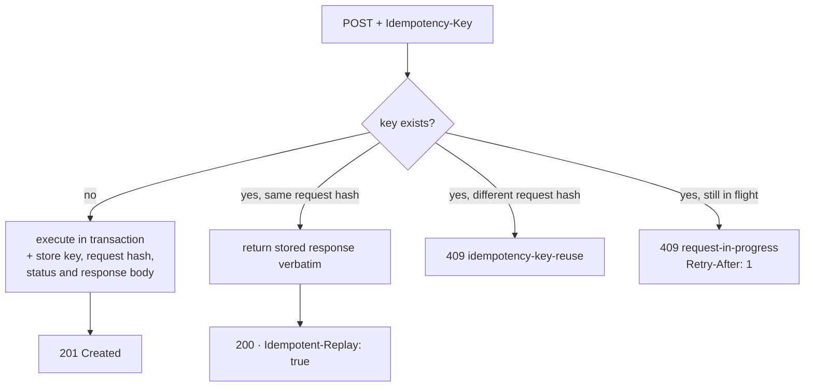

# API contract

The API is the *entire* public surface. There is no frontend, and there is no private back door —
the simulator, the demo page and any future UI all consume exactly what is documented here.

That constraint is the point. See [ADR-0008](adr/0008-simulator-as-external-client.md).

- [Conventions](#conventions)
- [Errors](#errors)
- [Idempotency](#idempotency)
- [Endpoints](#endpoints)
- [SSE streams](#sse-streams)
- [Contract testing](#contract-testing)

---

## Conventions

| | |
|---|---|
| **Spec** | OpenAPI 3.1, generated from the code, served live at `/openapi.json` (FastAPI's default) — not yet committed to the repo as a diffable file, see "Contract testing" below |
| **Streams** | Not yet documented as AsyncAPI — see "Contract testing" below |
| **Auth** | `X-API-Key` plus `X-Role: manager\|cashier\|chef\|waiter`. A deliberate stand-in — see below |
| **Commands** | REST, mutating verbs on nouns. State transitions are `POST /…/{action}`, not `PATCH {status}` |
| **Reads** | REST for point-in-time, SSE for live |
| **Correlation** | `X-Request-ID` accepted or generated; echoed on every response, carried through every event |
| **Time** | RFC 3339, always UTC, always with offset |
| **Money** | String-encoded decimals plus explicit `currency`. Never a float in JSON |

**On authentication.** Real auth is out of scope and says so loudly. What is *not* out of scope is
that authorisation is checked in one place, per endpoint, declaratively:

```python
@router.post("/orders/{order_id}/void", dependencies=[requires(Role.MANAGER)])
```

Swapping the stand-in for OIDC changes one dependency and no business logic. Faking the identity
source is a scope decision; scattering role checks through use cases would be a design defect.

`manager` is a superset of every other role: the person running the pizzeria can do anything a
cashier, chef or waiter can, so `requires(Role.CASHIER)` etc. implicitly also accepts `manager` —
see `deps.requires`. `POST /orders/{id}/void` above is `Role.MANAGER`-only in the literal sense
that no other role reaches it, not because manager is special-cased differently from the rest.

**Why actions, not status patches.** `PATCH /orders/{id} {"status": "CANCELLED"}` invites the client
to reason about the state machine. `POST /orders/{id}/cancel` keeps that knowledge in the domain and
lets the server answer `409` with a reason. The FSM belongs on one side of the wire.

---

## Errors

RFC 9457 `application/problem+json`, uniformly.

```json
{
  "type": "https://forno.dev/problems/illegal-transition",
  "title": "Illegal state transition",
  "status": 409,
  "detail": "Order 9a1c… cannot be cancelled: an item has already entered the oven.",
  "instance": "/orders/9a1c…/cancel",
  "current_status": "IN_KITCHEN",
  "attempted": "CANCELLED",
  "request_id": "c-91"
}
```

| Status | Meaning here |
|---|---|
| `400` | Malformed request — the payload itself is wrong |
| `403` | Role lacks permission for this command |
| `404` | Unknown identifier |
| `409` | **Well-formed, but the current state forbids it.** The interesting one |
| `422` | Semantically invalid — unknown menu item, table already occupied |
| `429` | Reserved for rate limiting — not emitted today; the simulator's client already honours `Retry-After` |
| `503` | Not ready — Postgres unreachable. The honest answer, never a queued lie |

`409` versus `422` is a real distinction, not pedantry: `409` means *try again later or take a
different action*, `422` means *this request will never work*. Clients branch on it, and the
simulator's cashier actor proves that branch is exercised on every run.

Domain exceptions are mapped at the edge by a FastAPI exception handler. `domain/` never imports
`HTTPException` — that is enforced by import-linter, not discipline.

```python
@app.exception_handler(IllegalTransition)
async def _(request: Request, exc: IllegalTransition) -> JSONResponse: ...
```

---

## Idempotency

**Every mutating endpoint accepts `Idempotency-Key`.** A cashier double-tapping submit is the most
realistic bug in this domain, and it is handled once, at the edge, rather than per endpoint.



Keys are stored with the request hash and a 24-hour TTL, and are written **in the same transaction
as the state change** — otherwise the window between commit and key-write is exactly the crash that
produces a duplicate order.

Reusing a key with a *different* body is a client bug and is reported as one rather than silently
serving a stale response.

---

## Endpoints

Thirty routes: 8 management, 6 ordering, 5 kitchen, 3 service, 2 statistics, 3 streams, 3
infrastructure. Four roles × full CRUD is how this kind of project dies at 40% complete.

### Management — `X-Role: manager`

| Method | Path | Notes |
|---|---|---|
| `POST` | `/menu/items` | Create. Idempotent |
| `PATCH` | `/menu/items/{id}` | Price and availability. Never rewrites placed orders |
| `GET` | `/menu` | `?available_only=true` |
| `POST` | `/stations` | Ovens and prep stations, with slot counts and bake times |
| `PATCH` | `/stations/{id}` | `{"active": false}` takes an oven out of service (pizzas in it finish; nothing new goes in); `true` brings it back |
| `GET` | `/stations` | Current occupancy |
| `POST` | `/tables` | Number and seats |
| `GET` | `/tables` | Occupancy and current order |
| `POST` | `/shifts` | Staff on shift — feeds capacity in `KitchenState` |

**These are how a pizzeria is configured.** The simulator's manager actor calls exactly these
endpoints from the scenario YAML on every run. There is no separate seeding path, so the management
API is exercised end to end every single time anyone types `make demo` — and it cannot silently rot.

### Ordering — `cashier`

| Method | Path | Notes |
|---|---|---|
| `POST` | `/orders` | Body carries `channel`, optional `table_number`, lines with `fire_group`. Returns `promised_at` |
| `GET` | `/orders/{id}` | Full state including per-item status |
| `GET` | `/orders` | `?status=&table=&since=&limit=` — cursor paginated |
| `POST` | `/orders/{id}/cancel` | `409` once any item has entered the oven (still baking, ready, or scrapped after baking) |
| `POST` | `/orders/{id}/void` | Manager role. Write-off of an order that was made but will not be paid for (walkout, complaint); legal from `IN_KITCHEN` on |
| `POST` | `/orders/{id}/close` | Finalises the receipt |

### Kitchen — `chef`

| Method | Path | Notes |
|---|---|---|
| `GET` | `/kitchen/tickets` | Read model. `?station=&status=` — the KDS refresh-and-recover call |
| `POST` | `/kitchen/tickets/{tid}/items/{iid}/start` | Claim at a prep station |
| `POST` | `/kitchen/tickets/{tid}/items/{iid}/oven-in` | Allocates a slot; `422` if none free |
| `POST` | `/kitchen/tickets/{tid}/items/{iid}/ready` | Releases the slot, evaluates fire-together |
| `POST` | `/kitchen/tickets/{tid}/items/{iid}/scrap` | `{reason}`. Spawns a prioritised remake |

Chef commands are addressed against the ticket but **routed back through the order aggregate**,
which is where the invariants live. The ticket is a projection; it is never written directly by a
command handler. [ADR-0006](adr/0006-kitchen-tickets-as-projection.md).

### Service — `waiter`

| Method | Path | Notes |
|---|---|---|
| `POST` | `/orders/{id}/items/{iid}/delivered` | Idempotent. Double-delivery is invariant #1 in the simulator |
| `POST` | `/tables/{number}/seat` | `{party_size}` |
| `POST` | `/tables/{number}/clear` | |

### Statistics

| Method | Path | Notes |
|---|---|---|
| `GET` | `/stats/summary` | `?from=&to=` — covers, revenue, median ready time, breach rate, remake rate |
| `GET` | `/stats/timeseries` | `?metric=&bucket=5m` — served from projected aggregates, not `count(*)` over orders |

Aggregates are maintained incrementally by `projector-stats`, which is the whole reason a second
projector exists. Computing them on read would be simpler and would fall over exactly when someone
opens the dashboard during the rush — which is the only time anyone opens it.

### Infrastructure

| Method | Path | Notes |
|---|---|---|
| `GET` | `/health/live` | Process is up. Never touches dependencies |
| `GET` | `/health/ready` | Postgres reachable, migrations current, consumer assigned |
| `GET` | `/metrics` | Prometheus exposition |

Liveness and readiness are genuinely different checks. A liveness probe that queries the database
restarts healthy pods during a database blip and turns a degradation into an outage.

---

## SSE streams

`text/event-stream`, `GET`, role-scoped. (Not yet documented as a committed AsyncAPI spec — see
"Contract testing" below.)

| Stream | Role | Events |
|---|---|---|
| `/streams/kitchen` | chef | `ticket.item.state_changed`, `ticket.cancelled` |
| `/streams/service` | waiter | `order.ready`, `item.ready` |
| `/streams/floor` | manager | `order.placed`, `order.closed` |

```
id: 48213
event: ticket.item.state_changed
data: {"schema_version":1,"event_id":"…","order_id":"…","ticket_id":"…","item_id":"…",
data: "status":"IN_OVEN","oven":"deck-1","slot":3,"correlation_id":"c-91",
data: "occurred_at":"2026-07-22T18:41:07Z"}
```

**Three properties make these usable rather than decorative:**

`Last-Event-ID` is accepted on reconnect, but the stream keeps no replay buffer: a reconnecting
client re-reads the read model (`GET /kitchen/tickets`, `GET /orders?status=READY`) and resumes
live from there — which is exactly what the simulator's waiter does.

**Slow subscribers are dropped, not tolerated.** Each connection has a bounded queue. On overflow the
server emits `stream.desync` and closes. Applying backpressure from one laggy client to the whole
fan-out would be the wrong trade every time.

**The stream is never the source of truth.** A client that misses everything recovers with one
`GET /kitchen/tickets`. That is what makes dropping slow clients safe, and it is why the read model
exists as a queryable table rather than only as a stream of deltas.

**Not implemented yet:** a derived `order.promise_at_risk` event — firing when an order is
projected to breach before it actually has, the difference between a display that lets a kitchen
react and one that only reports history. `TableSeated`/`TableCleared` are also real domain events
(`domain/events.py`) with no SSE route wired up yet. Both are plausible next additions, not
currently wired to anything — listed here so a `curl -N` session against these streams isn't
mistaken for evidence they're missing on the wire.

---

## Contract testing

Three gates were designed in, because "the API is the whole product" is only true if it is
verified. One is real today.

**Consumer-driven, via the simulator — the one that's built.** The strongest gate, and the one that
actually runs. Every actor role exercises its workflow over the real transport, under concurrency,
and the shadow ledger asserts a small set of system-level invariants on what it observed (see
[Simulator](simulator.md) "The shadow ledger" for exactly which). If a response shape or a status
code changes in a way that breaks a plausible client, the actor calling it errors out.

**Schema conformance and committed spec diffing — designed, not built.**
`tests/contract/test_openapi_conformance.py` and `test_asyncapi_conformance.py` are both present
but `@pytest.mark.skip`, with skip reasons that predate the current implementation (they still say
"API not yet implemented" and "SSE streams not yet implemented" — both are implemented now; the
tests were simply never filled in). Neither `openapi.json` nor `asyncapi.json` is committed to the
repo, and no CI step regenerates or diffs either. `GET /openapi.json` is genuinely live — it's
FastAPI's own default, not something this project built — but there is currently no gate stopping
it from drifting silently.

That simulator gate is the answer to the obvious objection to a backend-only repository. The claim
is that the API fully supports a frontend. The simulator is a client that never renders anything —
and if it can do every role's job through the public contract alone, the claim holds.
