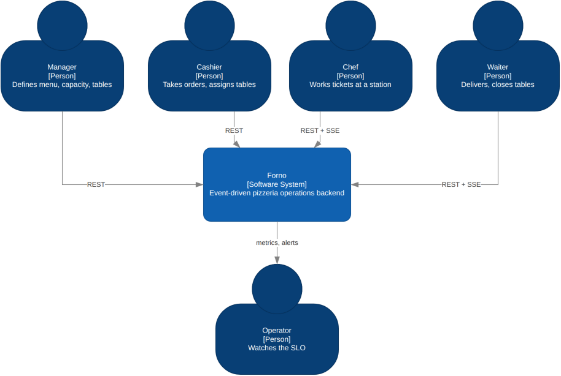
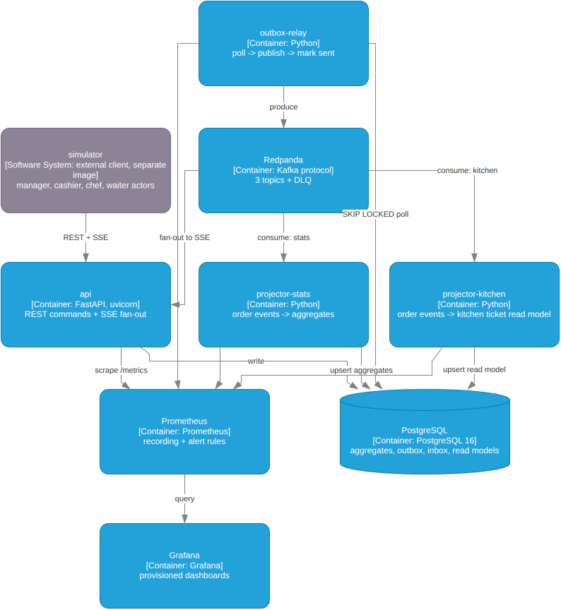
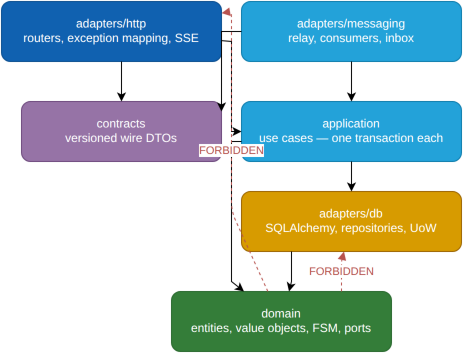
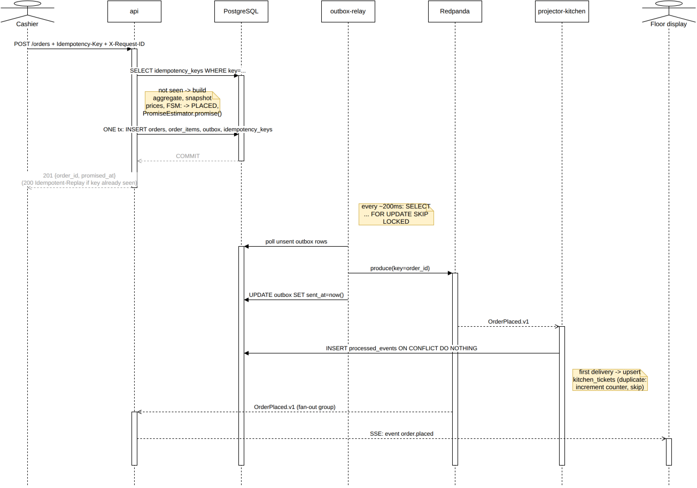
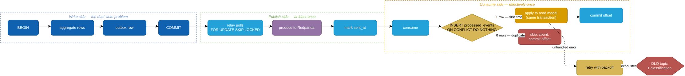
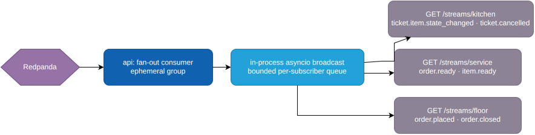
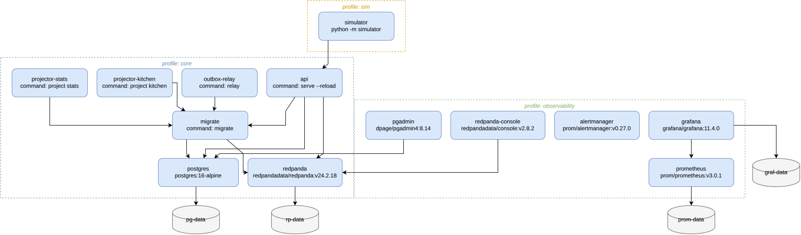

# Architecture

- [System context](#system-context)
- [Containers](#containers)
- [Layering](#layering)
- [Placing an order](#placing-an-order-the-critical-path)
- [Reliability machinery](#reliability-machinery)
- [Streaming to clients](#streaming-to-clients)
- [Topics and partitioning](#topics-and-partitioning)
- [Deployment topology](#deployment-topology)
- [Failure modes](#failure-modes)

---

## System context



Source: [`architecture-c4.drawio`](media/architecture-c4.drawio), page 1 (drill down from the Forno
box to Containers). See [`docs/media/README.md`](media/README.md) for how these are regenerated.

There is no frontend in this repository. There are four **client roles**, each fully served by the
public contract, and each exercised on every demo run by a simulated actor. See
[ADR-0008](adr/0008-simulator-as-external-client.md).

---

## Containers



Source: [`architecture-c4.drawio`](media/architecture-c4.drawio), page 2. For the exact service
topology (images, commands, volumes, compose profiles) rather than this logical container view,
see [Deployment topology](#deployment-topology) below — that one is generated directly from
`docker-compose.yml`.

### Why one image with three roles

`api`, `outbox-relay` and the two projectors are the **same container image invoked with different
commands**. This is how the system would actually deploy, it keeps the dependency set identical
across processes, and it makes the process/config separation legible without dragging Kubernetes
manifests into a portfolio repository.

```dockerfile
# conceptually
FROM base AS runtime
ENTRYPOINT ["forno"]
# docker compose:
#   api:       command: ["serve"]
#   relay:     command: ["relay"]
#   kitchen:   command: ["project", "kitchen"]
#   stats:     command: ["project", "stats"]
```

### Why `api` also consumes

Each `api` replica holds SSE connections for whichever clients happened to land on it, and every
replica therefore needs to see **every** event — not a partition share. So `api` subscribes with an
**ephemeral, replica-unique consumer group** (`sse-fanout-{hostname}-{boot_id}`) and always reads
from the log end. Projectors, which must each see every event exactly once across the fleet, use
**stable, shared groups**.

Using the same broker for two opposite delivery patterns, deliberately, is the point:

| Consumer | Group | Semantics | Offset on restart |
|---|---|---|---|
| `projector-kitchen` | `kitchen` (stable) | competing consumers, work divided | committed offset |
| `projector-stats` | `stats` (stable) | competing consumers, work divided | committed offset |
| `api` SSE fan-out | ephemeral, per replica | broadcast, every replica sees all | latest |

---

## Layering

Shallow hexagonal. Ports and adapters where they earn their keep, and nowhere else
([ADR-0010](adr/0010-abstraction-budget.md)).



Source: [`layering.drawio`](media/layering.drawio). Domain — green — is the one layer every
forbidden edge (red, dashed) points away from.

`domain/` imports nothing but the standard library. Not SQLAlchemy, not Pydantic, not FastAPI. This
is not an aspiration in a README — it is a CI gate:

```ini
# importlinter.ini
[importlinter:contract:domain-is-pure]
name = Domain layer imports no frameworks
type = forbidden
source_modules = forno.domain
forbidden_modules =
    fastapi
    sqlalchemy
    pydantic
    aiokafka
    forno.adapters
    forno.application
    forno.contracts

[importlinter:contract:layers]
name = Layered architecture
type = layers
layers =
    adapters.http
    adapters.messaging
    application
    domain
containers =
    forno

[importlinter:contract:simulator-is-external]
name = Simulator may not import the application
type = forbidden
source_modules = simulator
forbidden_modules = forno
```

Ten lines of configuration turn "clean architecture" from a claim into a failing build.

### Which abstractions exist, and why

| Port | Implementations | Justification |
|---|---|---|
| `PromiseEstimator` | `NaiveEstimator` (+ documented CP-SAT seam) | The extension point the whole design is aimed at |
| `EventPublisher` | `OutboxPublisher`, `InMemoryPublisher` | Two real implementations; makes application tests container-free |
| `Clock` | `SystemClock`, `ScaledClock`, `FrozenClock` | You cannot test promise-breach logic against `datetime.now()` |
| `OrderRepository` | one | Justified **not** as database swappability — that is a fiction — but as the single guarded write path that enforces FSM invariants |

Explicitly rejected: a DI container (`Depends` is one), a generic `Repository[T]`, a separate read
database, event sourcing, and any interface with exactly one implementation and no documented second.

---

## Placing an order: the critical path



Source: [`order-sequence.drawio`](media/order-sequence.drawio). Two branches the diagram
annotates as notes rather than full alt-frames (kept out of the auto-layout tool's scope, added by
hand): an already-seen idempotency key short-circuits straight to a replayed `200`; a duplicate
delivery at the projector increments a counter and skips instead of upserting again.

Three things to notice.

**The response is committed before the event is published.** The client is never told something
that is not durable. Publication lag is visible as `forno_outbox_lag_seconds` and alertable, rather
than being an invisible correctness hazard.

**The idempotency check and the write are the same transaction.** A cashier double-tapping submit is
the single most realistic bug in this domain, and it is handled at the edge for every mutating
endpoint.

**The correlation ID survives the async boundary.** `c-91` appears in the HTTP access log, the outbox
row, the Kafka header, the projector's structured logs, and the SSE event. One `grep` reconstructs
the whole journey.

---

## Reliability machinery



Source: [`reliability-machinery.drawio`](media/reliability-machinery.drawio).

**Why an outbox at all.** A database commit and a broker publish cannot be made atomic. Publishing
first risks announcing an order that never persisted; committing first risks a persisted order
nobody hears about. The outbox collapses both writes into one transaction and moves the failure into
a place where it is *visible and retryable*. Skipping this is the defect most "I used Kafka"
projects ship without noticing. [ADR-0002](adr/0002-transactional-outbox.md).

**Why an inbox.** The relay guarantees at-least-once, so redelivery is normal, not exceptional.
`processed_events(event_id, consumer)` as a composite primary key, written in the same transaction as
the read-model update, converts at-least-once delivery into effectively-once *effects* — which is
the only kind of exactly-once that exists. In the domain: no duplicate pizza.

**Failure classification.** DLQ messages carry a classification, because a human responds
differently to each:

| Classification | Cause | Response |
|---|---|---|
| `retryable` | broker/DB blip, timeout | automatic backoff, then DLQ if exhausted |
| `poison` | malformed or unknown schema version | never retried; DLQ immediately, alert |
| `caller_error` | event violates a domain invariant | DLQ, alert — this is a bug upstream |

`forno_dlq_messages_total` is labelled by classification for exactly this reason.

---

## Streaming to clients

Three SSE streams, each scoped to a role. Server→client only, which is why this is SSE and not a
WebSocket ([ADR-0004](adr/0004-sse-over-websockets.md)).



Source: [`streaming-to-clients.drawio`](media/streaming-to-clients.drawio). Event names here are
the ones `adapters/messaging/sse_fanout.py`'s `_routes()` actually emits — this replaces an
earlier version of the diagram (and matching stale wording in `streams.py`'s own endpoint
docstrings) that claimed `ticket.created` on the kitchen stream and `table.seated`/`table.closed`
on the floor stream, neither of which `_routes()` has ever produced. `TableSeated`/`TableCleared`
are real domain events (see `domain/events.py`) but currently have no SSE route at all.

Two operational details that matter more than the wiring:

**Bounded per-subscriber queues.** A slow client must not apply backpressure to the consumer. Each
subscriber gets a bounded queue; on overflow the connection is closed with a
`stream.desync` event, and the client reconnects and re-reads state from `GET /kitchen/tickets`.
Dropping a slow consumer is correct; stalling the whole fan-out to accommodate it is not.

**`Last-Event-ID` on reconnect.** Every SSE frame carries a monotonic per-stream ID. Browsers resend
it natively on reconnect, and the server replays from the read model. This is why the streams are a
*convenience layer over queryable state* rather than the source of truth — a client that misses
everything can still recover with one GET.

---

## Topics and partitioning

| Topic | Key | Partitions | Retention | Consumers |
|---|---|---|---|---|
| `forno.orders.v1` | `order_id` | 6 | 7 days | kitchen, stats, sse |
| `forno.kitchen.v1` | `order_id` | 6 | 7 days | stats, sse |
| `forno.menu.v1` | `menu_item_id` | 3 | compacted | kitchen, sse |
| `forno.orders.v1.dlq` | original key | 1 | 30 days | human |

**Keying by `order_id` is the entire ordering story.** Kafka guarantees ordering within a partition,
not across a topic. Every event for one order lands on one partition, so `OrderPlaced` can never be
processed after `ItemReady` for the same order — while unrelated orders still parallelise across six
partitions. Ordering per aggregate is the property the domain actually needs; global ordering would
be a needless serialisation of the whole restaurant.

`forno.menu.v1` is **log-compacted** rather than time-retained: it is a changelog of current state,
so a projector rebuilding from scratch needs the latest value per item, not the history.

### Wire contracts are not domain objects

`contracts/` holds versioned Pydantic DTOs, separate from the domain entities, with an explicit
mapping function between them:

```python
class OrderPlacedV1(BaseModel):
    schema_version: Literal[1] = 1
    event_id: UUID
    occurred_at: datetime
    order_id: OrderId
    items: list[OrderLineV1]
```

Serialising an aggregate straight onto a topic is what makes a system unrefactorable: the internal
model becomes a published API, and every rename is a migration. The mapping function costs twenty
lines and buys the freedom to reshape the domain whenever the domain needs reshaping. Consumers
reject unknown `schema_version` values as `poison` rather than guessing.

---

## Deployment topology

Compose profiles, so the stack you start matches what you are doing.

The diagram below is generated directly from `docker-compose.yml` — every service, image,
command, volume and profile grouping comes from parsing the file itself, not from someone
redrawing it by hand:



Regenerate it after editing the compose file:

```bash
python3 docs/media/generate-deployment-diagram.py --skill-dir /path/to/drawio-skill/skills/drawio-skill
drawio -x -f png -e -o docs/media/deployment-topology.drawio.png docs/media/deployment-topology.drawio
```

Why four profiles and not some other split: `core` is the minimum that makes the domain actually
work (api, workers, Postgres, Redpanda); `observability` is additive and never gates `core`
starting; `sim` and `load` are two different kinds of traffic generator (behavioural realism vs.
raw throughput — see [Simulator](simulator.md) "What it is not") and neither depends on the other.

```bash
docker compose --profile core --profile observability up      # = make up
docker compose --profile core --profile sim up                # = make demo
```

The image is multi-stage: `uv` for resolution, a non-root user, a pinned base image digest, and a
`HEALTHCHECK`. Targets are `dev` (editable install, hot reload), `test` (dev deps), and `prod`
(wheel only, no build toolchain).

`make up` must produce a healthy system in under sixty seconds, and `make demo` a populated one
within a minute of that. The compose smoke test in CI brings the stack up and polls
`/health/ready`; the system-invariants job then runs the full `busy-friday` service and fails the
build if any shadow-ledger invariant breaks.

---

## Failure modes

The system is designed against a specific list, and each one has a runbook entry and a way to
reproduce it.

| Failure | Detection | Behaviour | Reproduce |
|---|---|---|---|
| Relay dies | `forno_outbox_pending` climbing, `outbox_lag_seconds` | Orders still accepted and durable; events publish late on restart | `make chaos TARGET=relay` |
| Projector dies mid-service | consumer group lag | Tickets stale; on restart replays from committed offset, inbox suppresses duplicates | `make chaos TARGET=kitchen` |
| Duplicate delivery | `events_consumed_total{result="duplicate"}` | Suppressed by inbox; no duplicate pizza | `make chaos MODE=redeliver` — **not built yet**, see [Runbook](runbook.md) "Deliberate chaos" |
| Broker unavailable | relay produce errors | **Writes keep succeeding.** Postgres is the record; the outbox drains when the broker returns | `docker compose pause redpanda` |
| Postgres unavailable | readiness probe fails | Writes rejected with `503` — the honest answer | `docker compose pause postgres` |
| Slow SSE client | subscriber queue overflow | Connection dropped with `stream.desync`; client re-reads state | `make chaos MODE=slow-client` — **not built yet**, see [Runbook](runbook.md) "Deliberate chaos" |
| Poison event | `dlq_messages_total{classification="poison"}` | Straight to DLQ, offset committed, alert raised | publish a bad `schema_version` |
| Oven capacity lost | `oven_slots_occupied`, breach rate | Promises lengthen, SLO burns, alert fires | Not reproducible via `make demo SCENARIO=oven-down` yet — the scenario's fault never fires, see [Configuration](configuration.md) "Bundled scenarios" |

The critical line in that table is the broker one. **Redpanda being down is not an outage.** Orders
are still taken, still priced, still durable — the kitchen display simply lags until the outbox
drains. That property is a direct consequence of the "Postgres is the record, Kafka is propagation"
decision, and it is the clearest argument for it.
