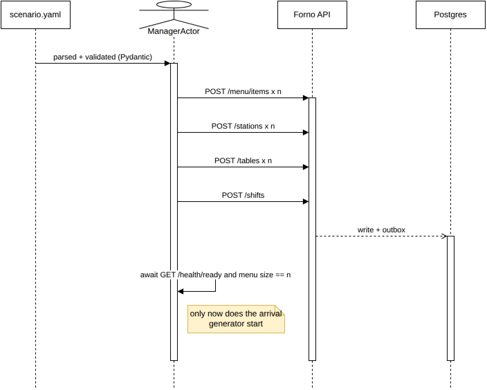

# Configuration

Two kinds of configuration exist in this project, and the boundary between them is a design
decision, not a filing convention.

- [The boundary](#the-boundary)
- [Scenario schema](#scenario-schema)
- [Bundled scenarios](#bundled-scenarios)
- [Runtime configuration](#runtime-configuration)
- [Bootstrap flow](#bootstrap-flow)

---

## The boundary

| Domain capacity — the application **must** know | Simulation behaviour — the application must **never** know |
|---|---|
| Oven count, slots per oven, bake time per item | Customer arrival rate and distribution |
| Prep stations and their throughput | Party size distribution |
| Staff on shift | How long a table deliberates before ordering |
| Table numbers and seats | Probability an item is scrapped |
| Menu, prices, VAT rates | Walkout threshold |
| Fire-together window | Random seed, time scale, duration |

The left column feeds `KitchenState` and therefore the `PromiseEstimator`. It is real domain state,
created through the public management API, stored in Postgres.

The right column exists only inside the simulator process.

**If `forno.domain` ever learns what a Poisson arrival rate is, the boundary has leaked.** That is a
concrete, checkable failure — the domain would then be modelling its own customers, which makes it
impossible to point at real traffic and impossible to reason about. The same import-linter contract
that keeps the simulator out of the application keeps this honest in the other direction.

---

## Scenario schema

One YAML file, two clearly separated top-level blocks, validated by a Pydantic model that fails fast
with readable errors. A typo in a scenario should be a one-line message, not a stack trace forty
seconds into a demo.

```yaml
# scenarios/busy-friday.yaml
name: busy-friday
description: >
  A well-staffed Friday evening with a 19:00 rush. Comfortable capacity —
  the SLO should hold.

pizzeria:                        # → pushed through the management API
  currency: PLN
  fire_together_window_seconds: 90

  ovens:
    - {name: deck-1, slots: 8, bake_seconds: 480}
    - {name: deck-2, slots: 6, bake_seconds: 480}

  stations:
    prep: {count: 2, seconds_per_item: 120}
    pass: {count: 1}

  staff: {cashiers: 1, chefs: 3, waiters: 2}

  tables:
    - {number: 1, seats: 4}
    - {number: 2, seats: 2}
    # …

  menu:
    - {sku: margherita, name: Margherita, price: "32.00", vat: "0.08",
       prep_seconds: 120, bake_seconds: 480, popularity: 0.35}
    - {sku: diavola,    name: Diavola,    price: "38.00", vat: "0.08",
       prep_seconds: 140, bake_seconds: 480, popularity: 0.25}
    - {sku: calzone,    name: Calzone,    price: "41.00", vat: "0.08",
       prep_seconds: 240, bake_seconds: 720, popularity: 0.10}

simulation:                      # → simulator only, never leaves the process
  seed: 42
  duration_minutes: 120
  time_scale: 120                # 480 domain seconds → 4 wall-clock seconds

  arrivals:
    model: poisson
    per_hour: 14
    rush: {at: "19:00", duration_minutes: 45, multiplier: 1.5}

  parties:
    size_weights: {1: 0.15, 2: 0.40, 3: 0.15, 4: 0.20, 6: 0.10}
    takeaway_ratio: 0.25

  behaviour:
    deliberation_seconds: {min: 60, max: 300}
    remake_rate: 0.03
    walkout_after_seconds: 1500  # ~25 minutes of patience
    double_submit_rate: 0.02     # exercises the idempotency path

  expect:                        # the simulator asserts against these
    breach_rate: {min: 0.0, max: 0.2}
    walkouts_max: 4
```

The `expect` block is what turns a scenario from a demo into a regression test. It declares the band
the system is supposed to land in, and the run fails outside it. Without it, a scenario can only
prove the system did not crash — with it, a scenario proves the system still performs.

---

## Bundled scenarios

| Scenario | Shape | What it demonstrates |
|---|---|---|
| `tiny-trattoria` | 6 tables, 1 oven ×4 slots, 1 chef, 1 waiter | The smallest configuration that works. Proves nothing is hardcoded to a large setup |
| `busy-friday` | 14 tables, 2 ovens, 3 chefs, 2 waiters, 19:00 rush | The default. The SLO holds |
| `understaffed` | Same demand, 1 chef, 1 oven | **Deliberately breaches the SLO.** Burns the error budget and fires the alerts |
| `oven-down` | `deck-2` removed 40 minutes in | Graceful degradation: promises lengthen, nothing is lost, breach rate climbs and recovers |
| `price-change` | Menu price raised mid-service | Asserts placed orders keep their snapshotted totals |

`understaffed` is the most useful file in the repository. Reproducibly firing your own production
alerts on demand, in one command, is a much stronger claim than having written alert rules.

**Scripted events go through the front door too.** `faults:` and `menu_changes:` are scheduled by
the simulator at their `at_minute` offset (domain minutes, scaled like everything else) and
executed by `ManagerActor` through the management API: `PATCH /stations/deck-2 {"active": false}`
for `oven-down`, `PATCH /menu/items/{id}` for `price-change`. The application never sees a
schedule — it only ever sees "the oven is off now", exactly as it would from a real owner.

The numbers in these files are meant to be a plausible pizzeria, not a stress test: a pizzaiolo
preps a pizza in two to four minutes and a deck oven bakes it in eight, so one chef serves twenty
to thirty pizzas an hour and a Friday with three chefs and fourteen oven slots comfortably handles
fourteen parties an hour until the rush. Guests give a sit-down pizzeria about twenty-five minutes
before they leave. Some late orders and the occasional walkout are what a real Friday looks like,
and the `expect` bands say so; `understaffed` is the one file that is supposed to end badly.

---

## Runtime configuration

Application configuration is environment variables only — 12-factor, one Pydantic `Settings` object,
validated at startup, with the process refusing to boot on anything invalid or missing.

| Variable | Default | Notes |
|---|---|---|
| `FORNO_DATABASE_URL` | — | Required |
| `FORNO_KAFKA_BOOTSTRAP` | — | Required |
| `FORNO_ROLE` | `serve` | `serve` / `relay` / `project` — selects the process's job |
| `FORNO_PROMISE_ESTIMATOR` | `naive` | The seam, selected by name at startup |
| `FORNO_PROMISE_GRACE_SECONDS` | `120` | The SLO threshold |
| `FORNO_TIME_SCALE` | `1` | Domain seconds per wall-clock second ([ADR-0009](adr/0009-scaled-domain-time.md)). `make demo`/`make live` set it from the scenario; `/health/ready` reports it and the simulator refuses a mismatch |
| `FORNO_OUTBOX_POLL_MS` | `200` | Relay poll interval |
| `FORNO_OUTBOX_BATCH` | `100` | Rows per poll |
| `FORNO_CONSUMER_MAX_RETRIES` | `5` | Before DLQ |
| `FORNO_SSE_QUEUE_SIZE` | `256` | Per-subscriber bound; overflow drops the client |
| `FORNO_METRICS_PORT` | `9100` | `/metrics` port for `relay`/`project` roles, which have no FastAPI process of their own; `serve` exposes `/metrics` on the main HTTP port instead |
| `FORNO_LOG_LEVEL` | `INFO` | |
| `FORNO_TRACING_ENABLED` | `false` | OTLP export |

No configuration files, no profiles, no layered override precedence. One source, validated once, at
boot. Every configuration bug this project can have is therefore a startup failure with a clear
message, rather than a surprise at 19:40.

Secrets never appear in defaults, and `Settings.__repr__` redacts anything whose name matches a
credential pattern — a five-line precaution that prevents a connection string turning up in a log
aggregator.

---

## Bootstrap flow

The subtle decision: **the manager actor configures the pizzeria through the public API.** There is
no fixture loader, no `seed.sql`, no startup hook that writes the menu directly into the database.



Source: [`bootstrap-sequence.drawio`](media/bootstrap-sequence.drawio).

Three things fall out of that choice:

**The management API is exercised on every single run.** Nobody has to remember to test it; the demo
cannot start without it working.

**There is one write path, so nothing can drift.** A separate seeding path is a second implementation
of the same rules, and it goes stale the moment a validation rule changes in only one of them.

**"Configure any pizzeria, from small to big" stops being a config feature and becomes evidence.**
The tiny and busy scenarios differ only in a YAML file, and both are proven to work by the same
mechanism a real owner would use on day one.

The cost is that bootstrap is a few seconds slower than a SQL fixture. That is the correct trade
here, and it is the kind of trade worth making explicitly rather than by default.
