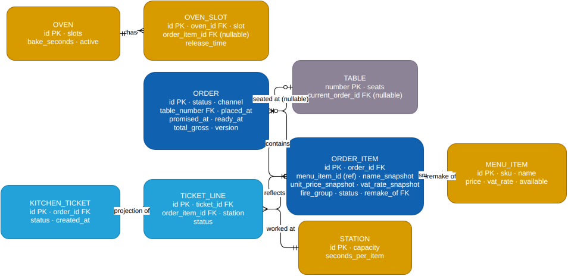
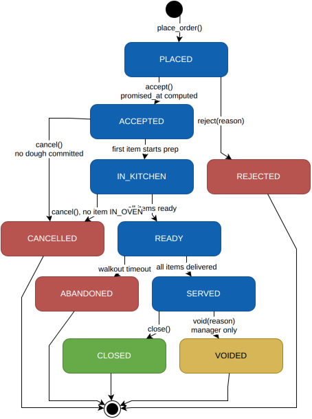
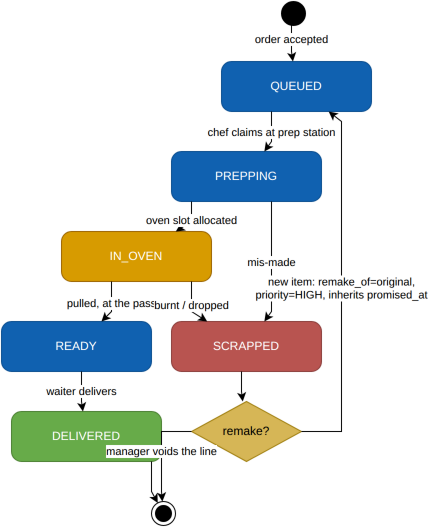
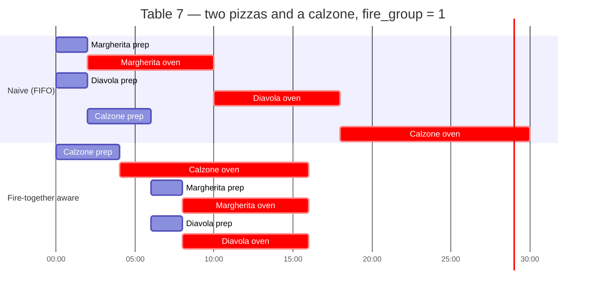

# Domain model

The whole business ruleset lives in `src/forno/domain/`, imports nothing but the standard library,
and is under 300 lines. If it grows past that, the model is wrong — that is a design smell, not a
formatting one.

- [Aggregates](#aggregates)
- [Order lifecycle](#order-lifecycle)
- [Item lifecycle](#item-lifecycle)
- [Fire-together](#fire-together-the-constraint-that-makes-this-interesting)
- [Money](#money)
- [Promised time](#promised-time)
- [Invariants](#invariants)
- [Testing the model](#testing-the-model)

---

## Aggregates



Source: [`aggregates-er.drawio`](media/aggregates-er.drawio), scoped to the domain model — the
reliability/reporting tables (`outbox`, `idempotency_keys`, `processed_events`, `stats_orders`,
`stats_remakes`, `shifts`) are deliberately left off; see
[`migrations/versions/0001_initial_schema.py`](../src/forno/adapters/db/migrations/versions/0001_initial_schema.py)
for the complete physical schema including those.

**`Order` is the aggregate root and the transactional boundary.** `KitchenTicket` is a read model
projected from order events — not a second write model
([ADR-0006](adr/0006-kitchen-tickets-as-projection.md)).

The decision that carries the most weight: **the order is not the unit of kitchen work.** The
kitchen works on individual *items*, at different *stations*, at different speeds — but must
synchronise their completion per order. Modelling `Order` and `KitchenTicket` as separate concerns,
with items as the shared grain, is what keeps the fire-together constraint expressible instead of
smeared across the codebase.

---

## Order lifecycle



Source: [`order-lifecycle.drawio`](media/order-lifecycle.drawio). Blue is the happy path, red the
abnormal-exit terminals (`REJECTED`/`CANCELLED`/`ABANDONED`), amber `VOIDED` (a manager correction,
not a failure), green `CLOSED` (successful completion).

The happy path is what everyone writes. The value is in the rest of it.

**`CANCELLED` is legal before any item enters the oven, and illegal after.** Dough is a committed
physical cost. This single rule is the reason the FSM is enforced by a transition table rather than
scattered `if status ==` checks — it is a rule about *elapsed physical process*, and it is exactly
the kind of thing that drifts when transitions are implicit.

**Illegal transitions return `409 Conflict`, not `400 Bad Request`.** The request was well-formed;
the *state* made it impossible. That distinction matters to any client trying to decide whether to
retry, and the simulator's cashier actor depends on it: when a cancel comes back `409`, it routes to
the manager for a void, exactly as a human would.

**`VOIDED` is not `CANCELLED`.** Voiding is the write-off for food that was made (or is being made)
but will not be paid for — a walkout after the dough went in, a complaint after service. It requires
the manager role, keeps the production record intact, and reverses only the money; pizzas still in
the oven free their slots, since no chef will ever mark them ready. It is legal from `IN_KITCHEN` on
— before that nothing has been made and `cancel` is the right verb. Collapsing the two loses the
audit trail — the reason a real system distinguishes them. (The diagram above predates the walkout
path and shows `VOIDED` reachable from `SERVED` only; the table below is authoritative.)

```python
# domain/order.py — the transition table is the specification
_TRANSITIONS: Final[Mapping[OrderStatus, frozenset[OrderStatus]]] = {
    OrderStatus.PLACED:     frozenset({ACCEPTED, REJECTED}),
    OrderStatus.ACCEPTED:   frozenset({IN_KITCHEN, CANCELLED}),
    OrderStatus.IN_KITCHEN: frozenset({READY, CANCELLED, VOIDED}),
    OrderStatus.READY:      frozenset({SERVED, ABANDONED, VOIDED}),
    OrderStatus.SERVED:     frozenset({CLOSED, VOIDED}),
}
```

---

## Item lifecycle



Source: [`item-lifecycle.drawio`](media/item-lifecycle.drawio). `IN_OVEN` is amber (physical
capacity held), `SCRAPPED` is red, `DELIVERED` is green.

**A remake is a new item, not a state on the old one.** It carries `remake_of` pointing at the
scrapped item, enters the queue with elevated priority, and — critically — **inherits the original
`promised_at`**. Resetting the promise on a remake would be self-serving: it would make the SLO look
good precisely when the customer's experience was worst. Inheriting it means remakes show up in the
breach rate, which is where they belong.

That one rule is why `forno_remakes_total` and the promise-breach SLI are correlated in the Grafana
dashboard rather than sitting on separate panels.

---

## Fire-together: the constraint that makes this interesting

Items in an order share a `fire_group`. Items in the same group must reach `READY` within a
configurable window (default 90 seconds), because the first pizza to arrive at a table is cold by
the time the fourth does.



FIFO finishes the margherita 22 minutes before the calzone. Working backwards from the longest item
brings all three to the pass together.

**The naive estimator does not solve this.** It computes a promise and lets FIFO happen, and the
resulting spread is visible in `forno_fire_group_spread_seconds`. That metric exists specifically so
the improvement from a real scheduler is measurable rather than asserted.

The domain carries everything a scheduler would need — `fire_group`, per-item prep and bake
durations, oven slot occupancy with release times, station capacities — regardless of whether
anything currently uses it. Shaping the *input* correctly is what makes the seam credible;
declaring the interface is the easy half. See [ADR-0007](adr/0007-cp-sat-promise-estimator-seam.md).

---

## Money

Four rules, none negotiable.

**`Decimal` everywhere, never `float`.** Binary floating point cannot represent 0.10, and money that
does not add up is the fastest way to lose a client's trust.

**Prices are snapshotted onto the order line at placement.** The manager raising the margherita price
at 18:00 must not retroactively alter the 17:45 receipt. `order_items` stores
`unit_price_snapshot`, `vat_rate_snapshot` and `name_snapshot` — the `menu_item_id` is a reference
for reporting, not a foreign key the total depends on.

The simulator asserts this: one scenario raises a price mid-service and checks that every previously
placed order's total is unchanged.

**A `Money` value object, never a bare `Decimal`.** Currency travels with the amount, arithmetic is
closed over the type, and comparing two currencies raises. Minor units are integers internally.

**VAT is computed per line and rounded once at the line, then summed.** Rounding the order total
instead produces off-by-one-cent discrepancies against a real till, which is the kind of bug that is
trivial to prevent and miserable to find later.

```python
@dataclass(frozen=True, slots=True)
class Money:
    minor: int
    currency: Currency

    def __add__(self, other: Money) -> Money: ...
    def with_vat(self, rate: VatRate) -> Money: ...
```

`NewType` for identifiers throughout — `OrderId`, `TableId`, `MenuItemId` — so it is *impossible* to
pass a table where an order belongs. Free at runtime, caught by `mypy --strict`.

---

## Promised time

`promised_at` is a first-class field computed once, at `ACCEPTED`, and never recomputed. It is the
anchor for the entire SLO and the reason the estimator port exists.

```python
class PromiseEstimator(Protocol):
    def promise(self, order: Order, state: KitchenState) -> PromisedTime: ...

@dataclass(frozen=True, slots=True)
class KitchenState:
    now: datetime
    ovens: tuple[OvenState, ...]        # slot occupancy + release times
    stations: tuple[StationState, ...]  # capacity + current claims
    queued: tuple[QueuedItem, ...]      # prep + bake durations, fire_group, priority
```

`NaiveEstimator` does the arithmetic a manager does in their head: every pizza waiting for a chef —
the backlog ahead plus this order's own — divided by the chefs on shift, plus the longest bake,
plus one extra oven round per batch of pizzas beyond the free slots, plus a fixed margin — capped
at twenty minutes,
because nobody quotes more and keeps the table (an honest forty-minute quote would never be
"late"; the customer would just leave). It ignores `fire_group`, priority and per-slot release
times — all of which are present because a constraint solver needs them. Durations are domain seconds; the returned `promised_at` is a wall-clock instant, so the ETA
is divided by `KitchenState.time_scale` ([ADR-0009](adr/0009-scaled-domain-time.md)).

Never recomputing the promise is deliberate. A promise that moves is not a promise, and an SLI
measured against a moving target measures nothing.

---

## Invariants

Enforced in the domain, verified by property tests, and re-verified end to end by the simulator's
shadow ledger.

| # | Invariant |
|---|---|
| 1 | No order reaches a terminal state without passing through a legal transition sequence |
| 2 | An order is `READY` if and only if every non-scrapped item is `READY` or `DELIVERED` |
| 3 | An item cannot be `IN_OVEN` unless an oven slot was allocated to it |
| 4 | Allocated oven slots never exceed the configured slot count |
| 5 | `total_gross == Σ(unit_price_snapshot × qty, with VAT)` over non-voided lines |
| 6 | A remake inherits the `promised_at` and `fire_group` of the item it replaces |
| 7 | `promised_at` is set exactly once, at `ACCEPTED`, and is never mutated |
| 8 | Cancellation is impossible once any item in the order has entered `IN_OVEN` |
| 9 | Every `DELIVERED` item belongs to an order that reached `READY` |
| 10 | Pizzas produced == ordered + remakes − scrapped |

---

## Testing the model

The domain suite is pure — no containers, no database, no event loop — and runs in under two seconds.

**Property-based FSM testing with Hypothesis.** A stateful test drives random legal command
sequences against the aggregate and asserts that no reachable state violates invariants 1–10, and
that every rejected command left the aggregate untouched.

```python
class OrderStateMachine(RuleBasedStateMachine):
    @rule(item=menu_items())
    def add_item(self, item): ...

    @rule()
    def cancel(self): ...

    @invariant()
    def never_ready_with_pending_items(self):
        if self.order.status is READY:
            assert all(i.is_finished for i in self.order.active_items)
```

Randomised sequences reach interleavings nobody thinks to write by hand — cancel-during-remake,
scrap-after-ready, deliver-twice — which is precisely where FSM bugs live.

**Test names are the specification.** `test_cannot_cancel_once_in_oven`,
`test_remake_inherits_original_promise`, `test_price_change_does_not_alter_placed_order`. Reading
the test names should read like the rules above, because they are the rules above.
