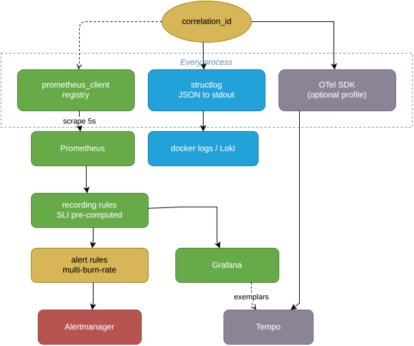
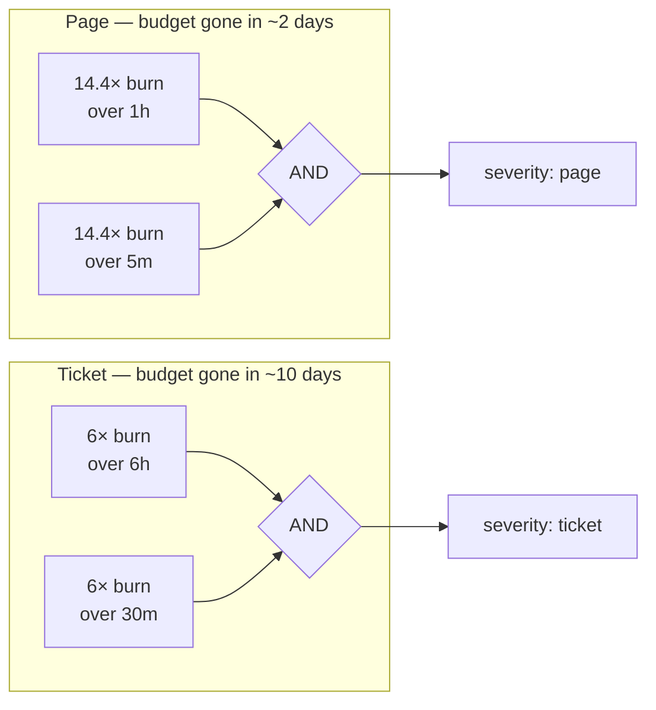

# Observability

Most projects instrument three things independently and call it observability. The test applied here
is narrower: **can one person, at 19:40 on a Friday, answer "is the kitchen coping, and if not,
why?"** Every metric below exists because it answers part of that question, and anything that did
not was removed.

- [The pillars, wired together](#the-pillars-wired-together)
- [Metric catalogue](#metric-catalogue)
- [Cardinality](#cardinality)
- [SLO](#slo)
- [Alerts](#alerts)
- [Dashboards](#dashboards)
- [Logging](#logging)
- [Tracing](#tracing)

---

## The pillars, wired together



Source: [`pillars.drawio`](media/pillars.drawio).

The dotted line from `correlation_id` to metrics is dotted on purpose: **the correlation ID is never
a metric label.** It reaches metrics only as an *exemplar* attached to a histogram bucket, which is
how you get from "p99 got worse" to "here is one of the slow ones" without exploding cardinality.

```
X-Request-ID  →  contextvar  →  structlog processor       (every log line)
                             →  outbox.correlation_id     (durable, survives restart)
                             →  Kafka header              (crosses the async boundary)
                             →  consumer structlog context (rehydrated)
                             →  SSE frame                 (visible to the client)
```

That chain is the single most important piece of instrumentation here. Without it, an async system
gives you a pile of logs from four processes with no way to relate them. With it, one order's entire
journey is `grep c-91`.

---

## Metric catalogue

All metrics carry the `forno_` prefix and follow Prometheus naming: base units, `_total` on
counters, `_seconds` on durations.

### Service level — the ones the SLO is built from

| Metric | Type | Labels | Notes |
|---|---|---|---|
| `forno_order_ready_seconds` | histogram | `channel` | Accepted → READY. Buckets tuned to the domain: 60, 120, 300, 480, 600, 900, 1200, 1800 |
| `forno_promise_late_seconds` | histogram | `channel` | Lateness beyond `promised_at` |
| `forno_promise_early_seconds` | histogram | `channel` | **Separate series.** Histograms cannot hold negatives, and one signed metric would silently discard half the distribution |
| `forno_orders_total` | counter | `channel`, `outcome` | `outcome` = served / cancelled / voided / abandoned / rejected |
| `forno_promise_breaches_total` | counter | `channel` | Ready later than `promised_at + 120s` |

Default histogram buckets go up to ten seconds, which is useless for something that takes eight
minutes. Choosing domain-appropriate buckets is a small thing that determines whether any percentile
in the dashboard means anything at all.

### Kitchen — where the answer to "why" lives

| Metric | Type | Labels | Why this and not the obvious one |
|---|---|---|---|
| `forno_kitchen_oldest_ticket_age_seconds` | gauge | `station` | **Age, not depth.** Depth without throughput is meaningless; ten tickets is fine at four minutes each and a catastrophe at twenty |
| `forno_kitchen_tickets_open` | gauge | `station`, `status` | Kept as context for age, never as the primary signal |
| `forno_oven_slots_occupied` | gauge | `oven` | Against `forno_oven_slots_total` — this is the "should we buy a second oven" metric |
| `forno_item_stage_seconds` | histogram | `stage` | queue → prep → oven → pass. Localises the bottleneck to a stage |
| `forno_fire_group_spread_seconds` | histogram | — | First-to-last item READY within an order: how long the first pizza waits at the pass for its siblings. **The metric the CP-SAT seam exists to improve** |
| `forno_remakes_total` | counter | `reason` | burnt / dropped / wrong-item |
| `forno_items_sold_total` | counter | `menu_item`, `size` | Bounded by menu size. The one vanity metric, kept because it is cheap and the manager asks for it |

### Reliability — the system watching its own joints

| Metric | Type | Labels | Notes |
|---|---|---|---|
| `forno_outbox_pending` | gauge | — | Unsent rows |
| `forno_outbox_lag_seconds` | gauge | — | Age of the oldest unsent row. **The leading indicator for the whole system** |
| `forno_outbox_published_total` | counter | `result` | ok / error |
| `forno_relay_batch_seconds` | histogram | — | Poll-to-publish duration |
| `forno_events_consumed_total` | counter | `topic`, `consumer`, `result` | applied / duplicate / failed. `duplicate` proves the inbox is working |
| `forno_consumer_lag_messages` | gauge | `group`, `topic`, `partition` | High-water mark minus committed offset, observed by the projector itself after each commit |
| `forno_projection_lag_seconds` | gauge | `projector` | Event `occurred_at` → applied. What a user would actually feel |
| `forno_dlq_messages_total` | counter | `topic`, `classification` | retryable / poison / caller_error — three different human responses |
| `forno_idempotency_replays_total` | counter | `endpoint` | Double-submits caught at the edge |

### Edge

Standard RED via `prometheus-fastapi-instrumentator`, with **route templates, never raw paths** —
`/orders/{order_id}`, not `/orders/9a1c…`. Plus `forno_sse_connections` (gauge, by stream) and
`forno_sse_dropped_total` (counter, by reason).

---

## Cardinality

Written down because unbounded labels are a production outage that arrives quietly.

**Never a label:** `order_id`, `table_number`, `ticket_id`, `correlation_id`, raw URL path, error
message, customer identifier.

**Bounded and permitted:** `station` (~5), `oven` (~3), `menu_item` (~20, capped by menu size),
`channel` (2), `status` (~8), `classification` (3), `result` (3), `stage` (4).

Worst case across the whole registry is a few thousand series. `menu_item` is the only label that
grows with data, and it is bounded by a menu a human maintains — a fact worth stating explicitly,
because it is the one that would break first if the system grew a thousand-item catalogue.

Per-order detail lives in **logs and traces**, which are built for high cardinality. Metrics are for
aggregates. Conflating the two is the single most common instrumentation mistake.

---

## SLO

> **95% of accepted orders reach `READY` no later than `promised_at + 120 seconds`,
> measured over a rolling 30-day window.**

Three deliberate choices in that sentence.

**Measured against the promise, not a fixed duration.** A 12-minute wait is fine if the customer was
told 12 minutes, and unacceptable if they were told 6. The promise is what was communicated, so it is
what should be measured. This also means a bad estimator burns the budget — which is exactly the
pressure that makes the CP-SAT seam worth building.

**120 seconds of grace.** Below that, lateness is indistinguishable from a waiter picking up the
plate a bit slowly. The threshold encodes the smallest gap a customer would notice.

**Remakes inherit the original promise**, so a burnt pizza shows up as a breach. Resetting the clock
would make the SLI look best precisely when the experience was worst.

### Recording rules

```yaml
groups:
  - name: forno-sli
    interval: 30s
    rules:
      - record: forno:promise_met:ratio_rate5m
        expr: |
          1 - (
            sum(rate(forno_promise_breaches_total[5m]))
            /
            sum(rate(forno_orders_total{outcome="served"}[5m]))
          )
      # …identical shape at 30m, 1h, 6h for the burn-rate windows
```

Pre-computing the SLI matters: it keeps dashboards fast, keeps alert expressions readable, and
guarantees the alert and the panel are computing the same number — a mismatch that is otherwise
almost impossible to notice.

### Error budget

5% over 30 days. At 400 orders a day that is 600 late orders per month — roughly 20 a day, which is
a number a restaurant manager can reason about. Expressing the budget in units the business
recognises is what stops an SLO from being decoration.

---

## Alerts

Multi-window, multi-burn-rate. A static "breach rate > 5%" threshold pages for a two-minute blip and
stays silent through a slow bleed that consumes the month's budget by the 9th.



The short window is the *reset* condition: it stops an alert firing for an hour after the incident
has already resolved.

```yaml
- alert: PromiseBudgetBurnFast
  expr: |
    (1 - forno:promise_met:ratio_rate1h)  > (14.4 * 0.05)
    and
    (1 - forno:promise_met:ratio_rate5m)  > (14.4 * 0.05)
  for: 2m
  labels: {severity: page}
  annotations:
    summary: "Kitchen is falling behind — promise breach burning error budget 14.4x"
    runbook: "https://github.com/<you>/forno/blob/main/docs/runbook.md#promisebudgetburn"
```

### Complete rule set

| Alert | Condition | Severity | Meaning |
|---|---|---|---|
| `PromiseBudgetBurnFast` | 14.4× over 1h and 5m | page | Service is failing now |
| `PromiseBudgetBurnSlow` | 6× over 6h and 30m | ticket | Chronic under-capacity |
| `OutboxLagHigh` | `outbox_lag_seconds > 30` for 2m | page | Relay stuck — kitchen displays are going stale |
| `OutboxBacklogGrowing` | `deriv(outbox_pending[10m]) > 0` for 15m | ticket | Producing faster than publishing |
| `ProjectionLagHigh` | `projection_lag_seconds > 60` for 5m | page | The KDS is showing the past |
| `DLQNotEmpty` | `increase(dlq_messages_total[15m]) > 0` | ticket | Something needs a human |
| `PoisonEventDetected` | `increase(dlq_messages_total{classification="poison"}[5m]) > 0` | page | Schema or contract break |
| `OvenSaturated` | `oven_slots_occupied / oven_slots_total > 0.95` for 10m | ticket | Capacity, not a defect |
| `TicketAgeExceedsPromise` | `oldest_ticket_age_seconds > 900` | page | Something is stuck, not merely slow |
| `RemakeRateHigh` | `rate(remakes_total[30m]) > 0.1 × rate(items_sold_total[30m])` | ticket | Quality problem upstream of the software |
| `ApiErrorRate` | 5xx ratio > 1% over 5m | page | Standard RED backstop |

Every alert has a `runbook` annotation pointing at a heading in [runbook.md](runbook.md). An alert
without a documented response is an alert that gets silenced.

**`make demo SCENARIO=understaffed` pushes the burn rate past the page threshold within its
one-minute run, reproducibly** — watch it cross the dashed line on the Service Health dashboard.
The `PromiseBudgetBurnFast` rule waits `for: 2m` before it pages, so to see the alert reach
*firing* (rather than *pending*) keep the stack up after the run instead of letting `make demo`
tear it down, or run the scenario against `make up`. Demonstrating that the alerting works is a
very different claim from writing alert rules, and it costs one YAML file.

---

## Dashboards

Two, provisioned as JSON in `deploy/grafana/dashboards/`. Not eight. A dashboard nobody can read
during an incident is worse than none.

### 1. Kitchen Ops — what a manager watches during service

Ordered so the eye lands on the answer first:

1. **At a glance** — open orders, oldest ticket age, orders ready in the last 15m, promise kept
   (1h, against the 95% target), walkouts in the last hour, oven utilisation
2. **Ticket age by station** — with the 900s alert threshold drawn on it
3. **Throughput per minute** — pizzas ordered vs. orders ready, served and walked out. Ordered
   climbing while ready stays flat is the kitchen falling behind
4. **Time to ready vs. promise** — p50/p95 placed → at the pass, plus how late the late ones were
5. **Fire-together spread** — p50/p95, the coursing quality signal (the number ADR-0007 is about)
6. **Oven utilisation by oven** and **where time goes** — mean seconds per stage, stacked, so a slow
   night is attributed to a stage, not to "slow"
7. **Pizzas sold**, **remakes by reason**, **open orders by channel**

### 2. Service Health — what an engineer watches

1. **SLO row** — SLI gauge (5m), error budget left over the 30-day window, and burn rate per
   window plotted against the 14.4× page and 6× ticket thresholds the alerts use
2. **Pipeline row** — outbox lag and pending (30s threshold), consumer lag per projector and
   partition, projection lag (60s threshold); then events consumed by result — the `duplicate`
   line being non-zero and harmless is the visual proof the inbox works — the DLQ by
   classification, and the edge guarantees (double-submits absorbed, SSE subscribers, slow
   clients dropped)
3. **RED row** — request rate by route, 5xx ratio against the 1% alert line, p95 latency by route.
   4xx are deliberately excluded from "errors": a 409 or 422 is the contract doing its job

Both dashboards show data within a minute of `make demo` or `make live` starting: the manager actor
bootstraps the pizzeria and the first customers order straight away. Durations are scaled domain
seconds ([ADR-0009](adr/0009-scaled-domain-time.md)); each dashboard says so in its description.

---

## Logging

`structlog`, JSON to stdout, one event per line. No log files, no rotation, no application-side
shipping — the runtime's job ([12-factor XI](https://12factor.net/logs)).

```json
{"event":"item.oven_in","level":"info","ts":"2026-07-22T18:41:07.221Z",
 "service":"api","correlation_id":"c-91","order_id":"9a1c…","item_id":"4b2f…",
 "oven":"deck-1","slot":3,"role":"chef","request_id":"c-91"}
```

**Rules that keep logs usable:**

Event names are stable dotted identifiers (`item.oven_in`), never interpolated prose. You can
`grep` and aggregate on them; you cannot aggregate on `f"Item {id} went into oven {oven}"`.

Context is bound once per request or message and inherited, so `correlation_id` is on every line
without being passed through twelve function signatures.

`INFO` marks domain state transitions. `DEBUG` is off in production. `ERROR` means a human might
need to act — anything that is handled and expected, like a `409` on a doomed cancel, is `INFO`.

No PII, no payment data, no full request bodies.

---

## Tracing

Optional, behind the `tracing` compose profile: OpenTelemetry SDK, OTLP to Tempo, and — the part
that matters — **W3C trace context propagated in the same Kafka headers as the correlation ID**. The
resulting waterfall spans `POST /orders` → outbox insert → relay publish → broker → projector →
read-model write → SSE emit, as one trace across four processes.

It is optional because it costs an extra container and a day of fiddling, and because the
correlation ID already gives you 80% of the value at 5% of the cost. Being explicit about that
trade-off is more useful than shipping tracing as a checkbox. Turn it on when you want the
`make chaos` recording to show a trace surviving a consumer restart — which is a genuinely good
thirty seconds of video.
