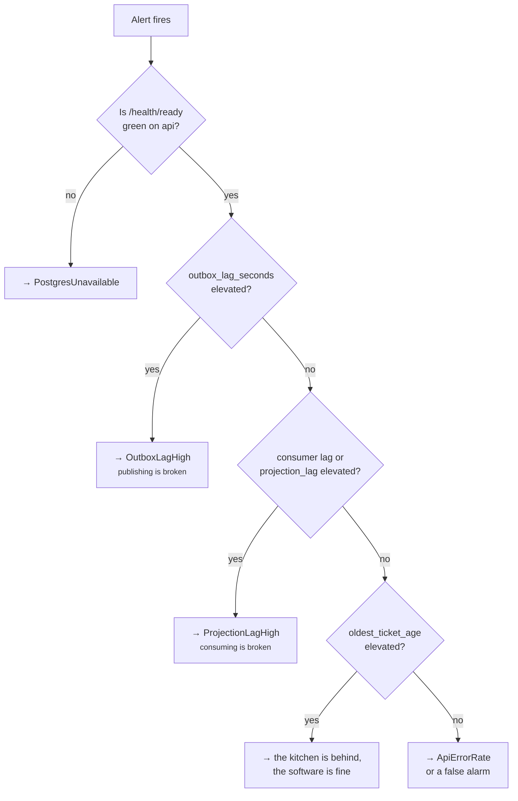

# Runbook

Every alert in [observability.md](observability.md) carries a `runbook` annotation pointing at a
heading here. An alert without a documented response is an alert that gets silenced.

Each entry follows the same shape: **what it means → how to confirm → what to do → how to reproduce
it deliberately.**

---

## Triage: the first sixty seconds



The branch that matters is the last one. **Most promise breaches are a capacity problem, not a
software problem.** Distinguishing "the system is broken" from "there are more customers than
chefs" is the entire purpose of separating pipeline metrics from kitchen metrics, and it is the
first question this runbook asks.

---

## PromiseBudgetBurn (Fast / Slow)

**Means.** Orders are arriving at `READY` later than promised, fast enough to consume the 30-day
error budget in roughly 2 days (fast) or 10 days (slow).

**Confirm.** Open *Kitchen Ops*. Read three panels in order:

| Reading | Interpretation |
|---|---|
| Ticket age high, oven utilisation ~1.0 | **Genuine capacity limit.** Not a defect |
| Ticket age high, oven utilisation low | Items are stuck before the oven — check prep station count and the stage breakdown |
| Ticket age normal, breach rate high | **The estimator is promising times the kitchen was never going to meet** |
| Remake rate elevated | Quality problem upstream; remakes inherit the original promise and count as breaches |

**Do.**

1. Capacity limit → add staff or ovens for the shift (`POST /shifts`, `POST /stations`). The
   estimator picks up new capacity on the next order.
2. Stuck before the oven → check `forno_item_stage_seconds{stage="prep"}`; usually a prep station
   short.
3. Estimator too optimistic → the correct long-term fix is a better `PromiseEstimator`. Short term,
   raise `FORNO_PROMISE_GRACE_SECONDS` **only** with a decision recorded, since it moves the goalposts
   rather than the outcome.
4. Elevated remakes → not a software response. Escalate to the kitchen.

**Reproduce.** `make demo SCENARIO=understaffed` fires this within about 90 seconds.

---

## OutboxLagHigh / OutboxBacklogGrowing

**Means.** Rows are sitting unpublished. **Orders are still being accepted and are durable** —
nothing is lost — but kitchen displays and projections are falling behind reality.

**Confirm.**

```bash
docker compose logs outbox-relay --tail=100
docker compose exec postgres psql -U forno -c \
  "select count(*), min(created_at) from outbox where sent_at is null"
```

**Do.**

| Cause | Symptom | Action |
|---|---|---|
| Relay crashed | No relay logs, `outbox_pending` climbing linearly | Restart. It resumes from unsent rows — the poll is `FOR UPDATE SKIP LOCKED`, so a partial batch is safe |
| Broker unreachable | Produce errors in relay logs | Fix the broker. The outbox drains automatically; **this is not an outage** |
| Genuine throughput ceiling | Relay healthy, `relay_batch_seconds` p99 near the poll interval | Raise `FORNO_OUTBOX_BATCH`, then run a second relay replica (safe — `SKIP LOCKED` handles the contention). Past that, see [ADR-0002](adr/0002-transactional-outbox.md) for the Debezium migration path |

**Do not** manually mark rows as sent. Publishing is at-least-once by design and consumers are
idempotent; skipping rows converts a delay into permanent data loss.

**Reproduce.** `docker compose pause redpanda`, then unpause and watch the backlog drain.

---

## ProjectionLagHigh

**Means.** Events are published but not applied. The KDS is showing the past.

**Confirm.**

```bash
docker compose exec redpanda rpk group describe kitchen
docker compose logs projector-kitchen --tail=100 | jq -r 'select(.level=="error")'
```

**Do.**

1. Consumer crash-looping → read the error. If it is one bad message, it should already have gone to
   the DLQ; if it did not, the classification logic is wrong and that is the bug.
2. Rebalancing repeatedly → session timeout too short relative to processing time. Increase it or
   reduce the batch size.
3. Genuinely behind → scale the projector up to the partition count (6). Beyond that, partitions are
   the ceiling and repartitioning is a planned operation, not a knob.

**Recovery is safe by construction.** The inbox (`processed_events`) makes reprocessing a no-op, so
resetting the consumer group to an earlier offset is a legitimate tool rather than a gamble.

```bash
rpk group seek kitchen --to start --topics forno.orders.v1   # full rebuild
```

**Reproduce.** `make chaos TARGET=kitchen`.

---

## DLQNotEmpty / PoisonEventDetected

**Means.** A message could not be processed after retries. The classification says which of three
very different things happened.

**Confirm.**

```bash
docker compose exec redpanda rpk topic consume forno.orders.v1.dlq --num 10 | \
  jq '{classification: .headers.classification, error: .headers.error, key: .key}'
```

**Do.**

| Classification | Meaning | Action |
|---|---|---|
| `retryable` | Transient failure outrunning the retry budget | Fix the dependency, then replay the DLQ into the source topic |
| `poison` | Malformed, or an unknown `schema_version` | **A contract break.** Deploy mismatch or a producer bug. Never replay blindly — fix the consumer or the producer first |
| `caller_error` | The event violates a domain invariant | A genuine bug upstream. Needs a code fix and an ADR if the invariant itself was wrong |

`poison` is a page and the others are tickets because a schema break means every subsequent message
of that type will fail too. It is the only DLQ condition that gets worse while you look at it.

**Reproduce.** Produce a message with `schema_version: 99`.

---

## TicketAgeExceedsPromise

**Means.** A ticket has been open for more than 15 domain minutes. Something is *stuck*, not merely
slow — this is qualitatively different from a burn-rate alert.

**Confirm.** `GET /kitchen/tickets?status=OPEN` and sort client-side by `created_at` — the endpoint
has no `sort` query param, and the `Kitchen Ops` dashboard's ticket-age panel is the faster way to
spot the oldest one anyway.

**Do.**

1. Item stuck in `PREPPING` with no chef → a chef client disconnected mid-claim. There is no
   auto-release by design; a human confirms whether the food exists. Reassign via the API.
2. Item stuck in `IN_OVEN` past bake time + 50% → the pizza is being forgotten. Scrap it and let the
   remake path run.
3. Ticket exists but the order does not → projection bug. Capture the `correlation_id` and file it;
   simulator invariant #3 exists to catch this before production.

---

## PostgresUnavailable

**Means.** `/health/ready` fails. Writes are rejected with `503`.

**This is the correct behaviour.** The alternative — accepting orders into a queue and hoping — means
telling a customer their food is coming when nothing recorded it. A `503` is honest and the cashier
falls back to paper, which is a workflow every restaurant already has.

**Do.** Restore Postgres. No application-side recovery is needed: in-flight transactions rolled
back, no outbox row exists for anything not committed, and clients retry with the same
`Idempotency-Key` without creating duplicates.

---

## ApiErrorRate

**Means.** 5xx ratio above 1%.

**Confirm.** *Service Health* → RED panel, split by route. Then follow an exemplar into a trace, or
`grep` the `correlation_id`.

**Do.** The common causes in order of likelihood: database connection pool exhaustion (the pool is
currently `create_async_engine(url, pool_pre_ping=True)` — SQLAlchemy's default size, not
configurable via an env var yet; a real fix here is adding that knob, not just restarting), a slow
query after data growth, and an unmapped domain exception leaking as a 500 — which is always a bug,
because every domain exception should map to a 4xx.

**A rise in 409s is not this alert and is usually not a problem.** It means clients are attempting
transitions the FSM forbids, which is the system working. Investigate only if the rate changes
sharply after a deploy.

---

## Deliberate chaos

Most of the failures above can be induced on demand today; the invariants job in CI exercises
the first one on every push.

```bash
make chaos                      # default: SIGKILL projector-kitchen at peak
make chaos TARGET=relay
docker compose pause redpanda   # broker outage
docker compose pause postgres   # database outage
```

The default `make chaos` kills the kitchen projector during a rush with dozens of orders in flight,
then asserts on recovery: consumer lag spikes and drains, `events_consumed_total{result="duplicate"}`
climbs (proving the inbox absorbed the redelivery), and every simulator invariant still passes.

Zero duplicate pizzas, zero orphaned tickets, no lost orders — demonstrated, not asserted. That
distinction is the reason this document exists.

**Two modes are declared but not built yet** — `make chaos` prints a "not yet implemented" message
for either, rather than silently doing nothing:

```bash
make chaos MODE=redeliver       # not yet implemented — would force a duplicate delivery
make chaos MODE=slow-client     # not yet implemented — would force an SSE subscriber overflow
```

`redeliver` needs a way to replay an already-committed Kafka offset (the inbox dedup path is
otherwise untestable from outside the process); `slow-client` needs a way to hold an SSE connection
open without draining it faster than `FORNO_SSE_QUEUE_SIZE` fills. Both are a real gap in this
runbook's chaos coverage, not a hidden feature — tracked here so the gap doesn't get rediscovered
by someone hitting the Makefile's own message.
