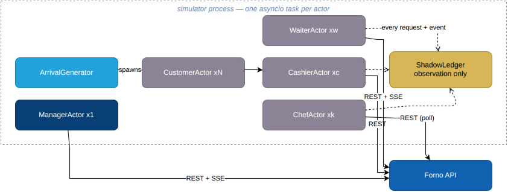

# Simulator

A discrete-event simulation of a working pizzeria: customers arrive, a cashier takes orders, chefs
work stations, waiters deliver, a manager handles voids. It is a demo, a load generator, a contract
test and a system-level property test — and it is one piece of code because of a single constraint.

> **The simulator is an external client. It talks to the public HTTP API and SSE streams, and
> nothing else.**

No imports from `src/forno`. No database connection. No shared session, no shared process. Enforced
by an import-linter contract in CI ([ADR-0008](adr/0008-simulator-as-external-client.md)).

Break that rule and the demo proves nothing — it becomes a program calling its own functions in a
loop. Hold it, and it proves the API is sufficient for a frontend that was never written.

---

## Naming

These are **actors** in the discrete-event simulation sense, not LLM agents. `CustomerActor`,
`ChefActor`, `WaiterActor`. The word "agent" in 2026 sets an expectation this repository
deliberately does not meet: an LLM-driven customer would destroy reproducibility, need API keys in
CI, and make every run non-reproducible. There is a clearly-labelled optional profile for that, and
nothing depends on it.

---

## Actors



Source: [`simulator-actors.drawio`](media/simulator-actors.drawio).

Each actor is a small asyncio task with an explicit state machine, around fifty lines. They are
readable enough to double as documentation of how a real client is meant to behave.

| Actor | Behaviour |
|---|---|
| `ManagerActor` | Reads the scenario, configures the pizzeria through the management API, watches the floor stream, voids orders a cashier could not cancel |
| `ArrivalGenerator` | Poisson arrivals with a configurable rush multiplier; spawns customers with a party-size distribution |
| `CustomerActor` | Deliberates, picks items (weighted by menu popularity), waits, walks out if the promise is badly broken |
| `CashierActor` | Takes orders, assigns a table or takeaway, retries on `429`, **routes a `409` cancel to the manager** |
| `ChefActor` | **Polls** `GET /kitchen/tickets` to discover queued items — the kitchen SSE stream only carries state *changes* a chef itself causes, never a new order's initial `QUEUED` items, so a pure-SSE chef could never discover new work. Has two hands: preps one item at a time, oldest ticket first, waits holding the pizza when the oven is full, and lets pizzas bake unattended while moving on to the next. Occasionally scraps at `remake_rate` |
| `WaiterActor` | Consumes the service stream (this one genuinely is pure SSE), walks a distance-proportional delay on `order.ready`, re-reads the order and delivers every READY item in one trip — the API refuses per-item delivery before the order is READY (invariant #9) |

### Actors that behave like real clients, badly

The most valuable behaviour in the list is the cashier's `409` handling. A cancel arrives after the
pizza entered the oven, the server refuses, and the cashier escalates to the manager for a void —
exactly as a human would. That path exists *only* because the simulator is external and has to obey
the contract. An in-process test harness would never discover it, because it would never be told no.

Other deliberately realistic misbehaviour: double-submitting orders (which the `Idempotency-Key`
absorbs), reconnecting SSE with a stale `Last-Event-ID`, and reading `GET /kitchen/tickets` to
recover after a forced desync.

---

## Determinism

**Same seed plus same scenario equals the same order stream, every run, on every machine.**

Each actor derives its own `random.Random` from the master seed via a stable name-based derivation:

```python
def rng_for(name: str, master_seed: int) -> Random:
    digest = hashlib.blake2b(f"{name}:{master_seed}".encode(), digest_size=8).hexdigest()
    return Random(int(digest, 16))
```

The consequence that matters: adding a second waiter does not reshuffle the customer arrival stream.
A single shared `Random` would make every configuration change also a workload change, so comparing
two runs would compare two different experiments.

That is why determinism is a prerequisite for the estimator seam, not a nicety: swapping
`NaiveEstimator` for a future solver (ADR-0007) is only a controlled experiment — one variable, a
measured difference — if the traffic underneath it is byte-for-byte identical across the two runs.

What is *not* deterministic: wall-clock scheduling of asyncio tasks, network jitter, and therefore
exact timestamps. The **sequence of decisions** is reproducible; the **exact microsecond timings**
are not, and the invariants are written to depend only on the former.

---

## Time

Domain durations are divided by `time_scale`. Wall clock is untouched.

| | 8-minute bake, `time_scale: 120` |
|---|---|
| Domain duration | 480 s |
| Wall-clock duration | 4 s |
| Prometheus scrape interval | 5 s — **unchanged** |
| `rate()` over 5m | still 5 real minutes — **still true** |

Accelerating wall-clock time instead would make every rate, every histogram and every burn-rate
calculation in Grafana a fiction. Scaling only domain durations keeps the observability stack
honest while compressing a two-hour service into about a minute.

The `Clock` port is what makes this one injected implementation rather than `sleep()` calls
scattered through six actors — which is why it was non-negotiable from the start
([ADR-0009](adr/0009-scaled-domain-time.md)).

The README and dashboards state plainly that latency histograms are in **scaled domain seconds**.
Being explicit about the distortion reads far better than pretending it is not there.

---

## The shadow ledger

The simulator maintains an independent model of what it believes happened, built **exclusively from
what an external client can observe**: the requests it sent, the responses it received, and the SSE
events it consumed. It never reads the database. That constraint has to be respected from the first
line of simulator code — it cannot be retrofitted.

At the end of a run it asserts a deliberately reduced subset of the following.
The **Status** column says which are implemented; the rest are either not
observable from outside the API at all, or not cheaply enough to be worth a
flaky assertion:

| # | Invariant | Catches | Status |
|---|---|---|---|
| 1 | No item observed `DELIVERED` more than once | Duplicate consumption, missing inbox | ✅ implemented |
| 2 | Every accepted order reached a terminal state within `duration + grace` | Stuck orders, lost events | not implemented |
| 3 | Every ticket seen on the kitchen stream maps to an order the simulator placed | Phantom tickets, projection bugs | not implemented |
| 4 | Every item ordered appeared in exactly one ticket | Dropped events at the projector | not implemented |
| 5 | Per-order event sequence never regresses | **The partition-ordering guarantee, verified end to end** | not implemented |
| 6 | `produced <= ordered + remakes − scrapped` | Remake accounting | ✅ implemented |
| 7 | Every receipt total matches prices at the time of placement | Price-snapshot violation | not implemented |
| 8 | Promise-breach rate falls within the scenario's declared band | Regression in the estimator or the kitchen model | ✅ implemented |
| 9 | Every `409` received was for a transition the FSM genuinely forbids | Over-strict or under-strict server | not implemented |
| 10 | No SSE stream delivered an event for an order the actor was not entitled to see | Authorisation leak in the fan-out | not implemented |
| 99 | Walkouts stay within the scenario's declared ceiling (`expect.walkouts_max`) | Regression in customer retention | ✅ implemented |

Invariant 5 deserves emphasis. The claim "keying by `order_id` gives per-order ordering" appears in
the architecture document. Invariant 5 is that claim being *tested*, over the real broker, under
concurrent load, on every CI run.

The report is printed at the end of every `make demo`:

```
─── forno simulation report ─────────────────────────────
 scenario  busy-friday    seed 7    duration 120m @ 120x
 orders    30 placed · 24 served · 0 cancelled · 1 voided · 1 walkout
 items     73 delivered (79 ordered + 3 remakes − 3 scrapped)
 promise   p50 -184s · p95 +20s (domain s vs promised_at) · breach 8.0%
 invariants  4/4 ✓
───────────────────────────────────────────────────────────
```

This is `print_report`'s actual output shape (`simulator/report.py`) — the format above matches
what `make demo` really prints, not the fuller report an earlier draft of this design sketched.

---

## Running it

```bash
make demo SCENARIO=busy-friday          # default: finite run, exits with the invariant report
make demo SCENARIO=understaffed         # breaches the SLO, fires the alerts
make demo SCENARIO=oven-down            # capacity loss mid-service
make demo SCENARIO=busy-friday SEED=7   # different stream, same rules

make live                               # open-ended, real time (time_scale: 1) — Ctrl-C to stop
```

Exit code is non-zero if any invariant fails, which is what lets it run as a CI gate.

### In CI

The simulator run is the **top gate** — the last thing before an image is published, and the one
whose failure is most informative.

```yaml
- name: System invariants
  run: make demo SCENARIO=busy-friday SEED=42
```

The full two-hour service at `time_scale: 120` is about one wall-clock minute and a few dozen
orders — enough concurrency for the ordering and idempotency invariants to be meaningful, and long
enough for the 19:00 rush to actually happen (a short cut-off serves a handful of orders and makes
the breach-rate band statistically meaningless).

This is stronger evidence than the unit suite, because it exercises the real transport, the real
broker, real concurrency and the real contract simultaneously — and it is the reason the unit suite
can stay small and fast instead of growing a wall of mocks.

---

## What it is not

It is not a load test. Measuring raw requests-per-second is a different job with a different goal —
throughput rather than behavioural realism — and conflating the two produces a tool that is bad at
both: too slow to find a throughput ceiling, too artificial to find a domain bug.
